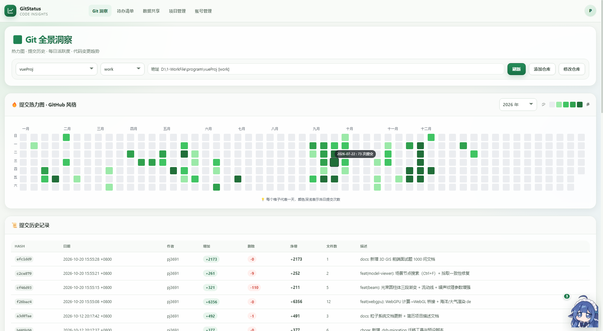
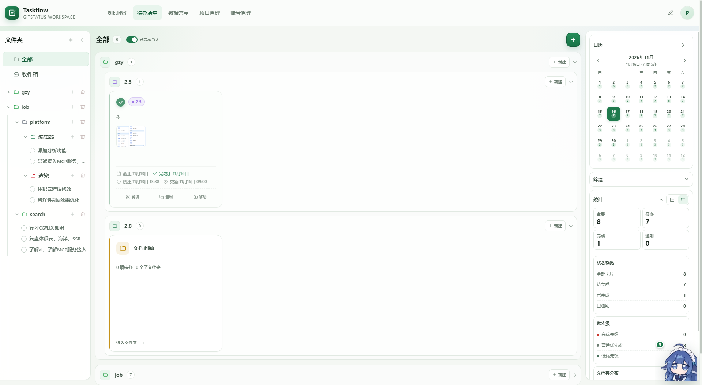
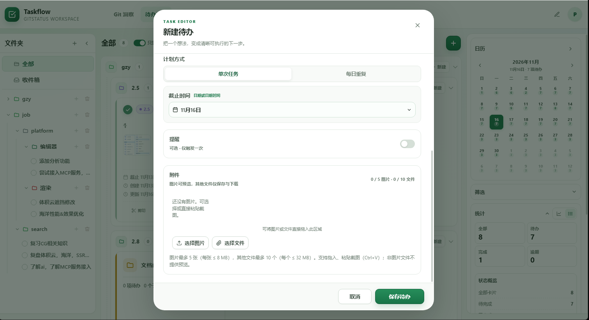
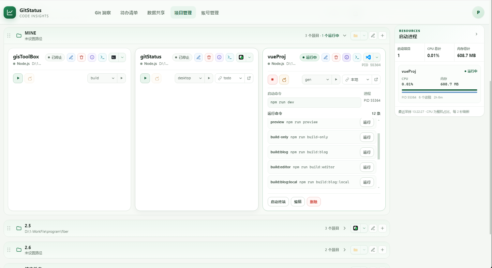
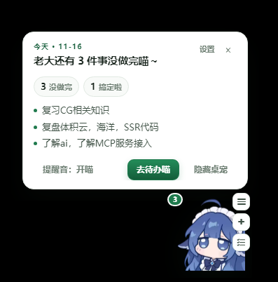
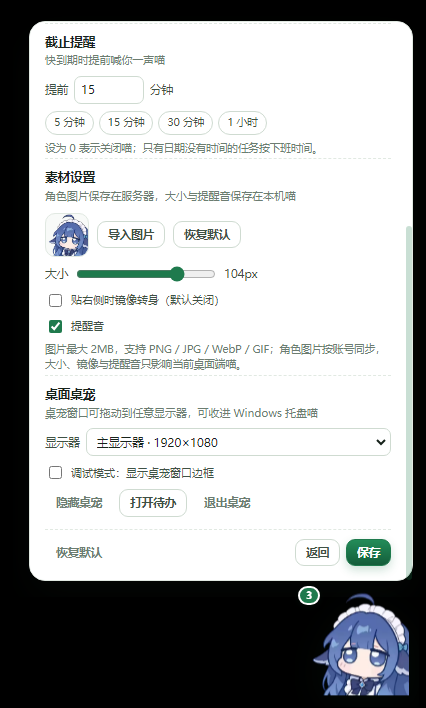

# GitStatus

一套自托管的本地小工具，把「Git 历史洞察 + 待办清单 + 博客文档 + 项目管理 + 桌宠提醒」放在同一个后端和同一套页面里。数据全部落在本机 SQLite 与本地目录，不依赖任何外部服务或 CDN。

> **桌宠的参考来源与素材声明**
>
> 桌宠的气泡造型与交互思路参考了 DeepSeek Harness（DSH）的社区插件 [MeteorNOX/DeepSeek-Balance-Whale-Widget](https://github.com/MeteorNOX/DeepSeek-Balance-Whale-Widget)（MIT）。本项目**没有收录相关任何美术素材**：仓库默认不带鲸鱼娘立绘，`src/` 与 `desktop/` 里也没有任何角色图片。
>
> 未导入素材时，网页端与桌面版桌宠都显示**内置的内联 SVG 兜底造型**，图片加载失败也会回退到它，不会白屏。想换成自己的形象：打开桌宠设置 →「素材设置」→「导入图片」，支持 PNG / JPG / WebP / GIF、单文件不超过 **2MB**，上传后按账号存在服务器（换机器登录会自动同步回来），「恢复默认」即回到内置 SVG。`自行取用第三方形象图前，请先确认该素材的授权范围`。

本文档只讲**怎么把项目跑起来**（网页端与桌面端的依赖下载和启动）。细节请看：

| 想了解的 | 去看 |
|---|---|
| 后端接口（路径、参数、权限、响应、错误码） | [docs/后端API说明.md](docs/后端API说明.md) |
| 桌面端桌宠（窗口架构、交互、打包） | [docs/桌面端使用说明.md](docs/桌面端使用说明.md) |
| 全部文档索引 | [docs/README.md](docs/README.md) |

---

## 一、功能总览

| 模块 | 入口 | 能做什么 |
|---|---|---|
| Git 全景洞察 | [`/pages/index.html`](#41-git-全景洞察--pagesindexhtml) | 类似 GitHub 首页的提交热力图、统计曲线、分页提交记录，数据来自本地仓库扫描 |
| 待办清单 | [`/pages/todo.html`](#42-待办清单--pagestodohtml) | 文件夹/标签/优先级/单次与每日重复任务、完成记录、提醒、图片与文件附件、注册与登录入口 |
| 项目管理 | [`/pages/projects.html`](#43-项目管理--pagesprojectshtml) | 本地项目一键启停、多命令终端运行、日志查看、文件夹分组与排序、端口占用排查、用编辑器打开 |
| 数据共享 | [`/pages/shares.html`](#44-数据共享--pagesshareshtml) | 把文件夹（含子文件夹）或收件箱按只读/可编辑共享给其他用户 |
| 账号管理 | [`/pages/account.html`](#45-账号管理--pagesaccounthtml) | 管理员审核新注册、分配角色、禁用账号、迁移用户数据 |
| 博客文档 | [仅 API](#46-博客文档无页面只有接口) | Markdown 文章的增删改查、全文搜索、与磁盘目录双向同步 |
| 桌宠 | [网页端挂件](docs/页面说明/通用交互与登录.md#五页面桌宠网页挂件) + [Windows 桌面版](#五桌面端electron-桌宠启动) | 当天待办统计气泡、间隔/上下班/截止提醒、自定义角色素材 |

本节（[四、页面使用说明](#四页面使用说明)）只做导览；每个页面的**详细**用法（字段、按钮、交互、限制、常见问题）分别写在 [docs/页面说明/](docs/README.md) 下的六篇文档里：[通用交互与登录](docs/页面说明/通用交互与登录.md) · [Git 全景洞察](docs/页面说明/Git全景洞察.md) · [待办清单](docs/页面说明/待办清单.md) · [项目管理](docs/页面说明/项目管理.md) · [数据共享](docs/页面说明/数据共享.md) · [账号管理](docs/页面说明/账号管理.md)。

### 界面速览

以下截图取自本机真实运行数据（仓库、项目与待办都是本机的），按页面依次展示。

**Git 全景洞察**（`/pages/index.html`）—— 仓库与分支选择器、GitHub 风格的年度提交热力图（鼠标悬停看当日提交数）、提交历史记录表。



**待办清单**（`/pages/todo.html`）—— 左侧文件夹树（树内可直接勾选完成）、中间按层级展开的文件夹与待办卡片流、右侧日历与统计；顶部「只显示当天」开关控制按日期可见性。



新建待办弹窗 —— 单次 / 每日重复、截止时间、提醒开关、图片与文件附件。



**项目管理**（`/pages/projects.html`）—— 项目卡片按分组排列，启停按钮、运行命令选择器与命名链接、展开后的命令列表；右侧「启动进程」侧栏实时显示 CPU 与内存占用。



**桌宠（网页端挂件）** —— 气泡里是当天待办统计与未完成列表，右下角是角色本体与待办数徽标。（图里的形象是**自行导入的素材**，不是默认造型）



**桌宠（Windows 桌面版）** —— 透明置顶小窗，思维气泡 + 鼠标悬停才显示的一列按钮。


桌面版设置面板（节选） —— 截止提醒、素材设置、桌面桌宠三段。



---

## 二、环境要求

| 组件 | 版本要求 | 说明 |
|---|---|---|
| Node.js | **20 及以上**（建议 22 LTS / 24） | `better-sqlite3` 官方预编译包只覆盖 `20.x ~ 25.x`，低于 20 会退化成本地编译 |
| npm | 10 及以上 | 随 Node 安装即可 |
| Git | 任意较新版本 | 后端通过 `git` 命令扫描本地仓库历史，命令行里必须能用 |
| 操作系统 | Windows 10 / 11 | 网页端跨平台可用；**桌面版只做 Windows** |

首次 `npm install` 会拉取 `better-sqlite3` 的原生二进制，国内网络下建议保持默认镜像或提前配置代理。

---

## 三、网页端启动

### 1. 下载依赖

在项目根目录执行：

```powershell
npm install
```

### 2. 启动后端

开发模式（nodemon 热重载，改动 `src` / `config` 自动重启，并在启动前释放 30012 端口）：

```powershell
npm run dev
```

只跑一次、不带热重载：

```powershell
npx tsx src/index.ts
```

启动成功后控制台输出 `server running: http://localhost:30012`。

> 端口固定在 **30012**（写在 `src/index.ts`）。这个端口是特意选在 Windows 保留端口段之外的，如果仍被占用，可以用 `netsh interface ipv4 show excludedportrange protocol=tcp` 查看冲突段。

### 3. 打开页面

浏览器访问根路径会自动跳到洞察页：

```
http://localhost:30012
→ http://localhost:30012/pages/index.html
```


### 4. 第一次使用

1. 洞察页会直接弹出登录框。此时还没有账号，点框里的链接**前往待办页注册**（注册与登录表单在 `/pages/todo.html`）。
2. **第一个注册的用户自动成为管理员**，注册完即拿到登录态；之后注册的用户都是 `readonly` + `pending`，需要管理员审核才能登录。
3. 管理员在 `/pages/account.html` 审核新注册（通过 / 拒绝），并按需把只读用户提升为读写。
4. 回到洞察页添加本地仓库路径（如 `D:/projects/my-repo`），点刷新即可看到热力图与提交记录。
5. 待办、项目管理、共享数据按需在对应页面添加；所有数据都写在本机 `src/output/` 下。

### 5. 数据落在哪里

| 路径 | 内容 | 是否入库（git） |
|---|---|---|
| `src/output/gitstatus.db` | SQLite 主库（用户、仓库、博客、待办、项目） | 否 |
| `src/output/logs/YYYY-MM-DD.log` | 按天切分的运行日志 | 否 |
| `src/output/todo-images/` | 待办附件与图片按用户分目录存放 | 否 |
| `src/output/pet-assets/` | 桌宠自定义角色素材 | 否 |
| `src/docs/` | 博客 Markdown 正文，按分类建多级目录 | 是 |

---

## 四、页面使用说明

五个业务页面各有一篇详细说明书，统一放在 `docs/页面说明/` 下（全部文档见 [文档索引](docs/README.md)）；本节只讲"这一页是干什么的、进去之后先看哪里"。**第一次用请先读 [通用交互与登录](docs/页面说明/通用交互与登录.md)**（导航、注册审核、角色权限、页面桌宠、本地存储键位都在这篇）。

| 页面 | 地址 | 详细文档 |
|---|---|---|
| 通用交互与登录 | 所有页面共用 | [docs/页面说明/通用交互与登录.md](docs/页面说明/通用交互与登录.md) |
| Git 全景洞察 | `/pages/index.html` | [docs/页面说明/Git全景洞察.md](docs/页面说明/Git全景洞察.md) |
| 待办清单 | `/pages/todo.html` | [docs/页面说明/待办清单.md](docs/页面说明/待办清单.md) |
| 项目管理 | `/pages/projects.html` | [docs/页面说明/项目管理.md](docs/页面说明/项目管理.md) |
| 数据共享 | `/pages/shares.html` | [docs/页面说明/数据共享.md](docs/页面说明/数据共享.md) |
| 账号管理 | `/pages/account.html` | [docs/页面说明/账号管理.md](docs/页面说明/账号管理.md) |

### 4.0 三分钟看懂权限模型

- **登录态**：未登录打开业务页会先看到登录面板；全站**只有待办页能注册**，其他页面只能登录。第一个注册的人自动是管理员，之后注册的是「只读 + 待审核」，要管理员点「通过」才能进。
- **三档角色**：`只读`（只看）< `读写`（管自己的数据、能用项目管理）< `管理员`（多一个账号管理页）。全系统**同时只有一个管理员**，页面上既不能新建也不能转移。
- **共享取交集**：能不能写某条待办，取决于「账号角色 ≥ 读写」**并且**「命中的共享权限 = 可编辑」。
- **本机限定**：附件用系统默认程序打开、用编辑器/终端打开项目目录、端口占用查询与结束进程、系统文件夹选择器 —— 这几类只在**浏览器和后端在同一台机器**时可用，远程访问会给出明确提示。

### 4.1 Git 全景洞察 · `/pages/index.html`

看某个本地 git 仓库都发生了什么。根路径 `/` 就跳这里。

- 顶部选**仓库**和**分支**，点「刷新」才真正扫描 git 历史（**新加的仓库必须先刷新一次**）。
- 四张卡片：GitHub 风格提交热力图、分页提交历史、可滚轮缩放的趋势曲线、每日提交统计（含「活跃指数」）。
- 数据全部来自 `git log` 真实输出，按分支分别缓存，切分支就是切一整套图表。

→ 权限限制、仓库面板字段、每张图的口径与算法、常见问题见 [Git全景洞察](docs/页面说明/Git全景洞察.md)。

### 4.2 待办清单 · `/pages/todo.html`

这一页功能最重，是全站的主工作区，也是唯一的注册入口。

- 三栏：**文件夹树**（多级、可多选、可拖拽）· **看板**（按文件夹分区铺卡片）· **日历 / 筛选 / 统计**。
- 任务支持单次与每日重复两种计划方式、一次性 / 每日两种提醒设置、图片与文件附件（拖入、Ctrl+V 粘贴都行）。
- 卡片的移动有三种方式：详情里的「移动」、剪切/复制后在树上「粘贴」、直接拖卡片到文件夹节点。
- 「只显示当天」开关决定看板与日历数字的口径，两者用的是同一套可见性判断。
- `?add=1` 直接弹出新建弹窗（桌宠的「＋」就走这个链接）。

→ 弹窗字段与校验、附件上限、日期语义、图片预览缩放、快捷键、共享数据的样子见 [待办清单](docs/页面说明/待办清单.md)。

### 4.3 项目管理 · `/pages/projects.html`

在**后端那台机器**上登记并运行本地项目：启停服务、跑构建命令、看实时日志。需要 `读写` 及以上角色，只读账号会被"需要读写权限"面板挡住。

- 填目录后点「识别」，后端按根目录的标志文件判定类型并推断启动命令，还能顺手生成一批运行命令（构建 / 测试 / 装依赖）。
- **启动命令**与**运行命令**是两套独立的东西：前者驱动启停与状态机，后者是一次性任务、各自占一个终端标签。
- 卡片上有：启停、重启、运行命令下拉、项目地址下拉、打开方式（文件管理器 / VS Code / Qoder IDE / PowerShell / CMD）、控制台。
- 项目可归进**文件夹分组**（拖卡片归组、拖手柄排序），右侧有每 2 秒采样的**进程占用**栏，工具栏还有**端口占用**排查与**一键启动**。

→ 识别规则表、状态机、终端与日志上限、端口保护名单、默认编辑器回退见 [项目管理](docs/页面说明/项目管理.md)。

### 4.4 数据共享 · `/pages/shares.html`

把自己的某个文件夹（含全部子文件夹与其中的任务）或收件箱授权给别的账号。

- 三个页签：`共享给我的` / `我共享出去的` / `全部共享`（最后一个仅管理员可见）。
- 只有**所有者或管理员**能改权限、取消共享；被共享方在自己的树里看到「共享 · 某用户」徽标，只读时写入口全部禁用。
- 同一个人 + 同一个范围重复创建不会报错，而是**把权限覆盖更新**。

→ 继承与取最高的算法、被共享方的完整观感、表结构约束见 [数据共享](docs/页面说明/数据共享.md)。

### 4.5 账号管理 · `/pages/account.html`

**仅管理员**可见（导航栏里那个入口对其他人根本不渲染）。

- 列表默认把**待审核**顶到最前；支持用户名搜索（输入即搜）、角色/状态筛选、每页 20 条。
- 待审核行只有「通过」和「拒绝」，**拒绝等于连数据一起删掉**。
- 可以建号、改名、重置密码、调角色（只读/读写）、启用禁用、迁移数据、删号；但**不能修改自己的角色与状态**，也不能把管理员交给别人。
- 「迁移」是整账号打包：分类按层级重建并同名合并、标签同名合并、任务与附件改归属（ID 不变）、源用户清空。

→ 唯一管理员的层层约束、迁移的逐项语义、删除的连带范围见 [账号管理](docs/页面说明/账号管理.md)。

---

### 4.6 博客文档（无页面，只有接口）

博客没有前端页面，统一通过 REST 接口维护，正文同时以 Markdown 落盘在 `src/docs/` 下（按分类建多级目录，**入库**）。常用做法：

```powershell
# 查文章列表（无需登录）
Invoke-RestMethod "http://localhost:30012/gitstatus/api/blogs?page=1&pageSize=20"

# 新增文章需读写权限；category 会作为 src/docs/ 下的子目录
Invoke-RestMethod -Method Post "http://localhost:30012/gitstatus/api/blogs" `
  -Headers @{ Authorization = "Bearer <token>" } `
  -ContentType "application/json; charset=utf-8" `
  -Body (@{ title = "标题"; content = "# 正文"; category = "notes" } | ConvertTo-Json)
```

改完磁盘或改完库后，调 `POST /gitstatus/api/blogs/refresh`（读写权限）做**磁盘 ↔ 数据库双向同步**。完整的参数表、字段与错误码见 [docs/后端API说明.md · 五、博客文章 API](docs/后端API说明.md#五博客文章-api)。

---

### 4.7 其他入口

| 地址 | 用途 |
|---|---|
| `/` | 重定向到 Git 洞察页 |
| `/pages/desktop-login.html` | 桌面版登录页（由桌宠应用内窗口加载，不要直接在浏览器里用） |
| `/pages/desktop-pet.html` | 旧版桌面渲染页，现已被 `desktop/renderer/` 三窗口架构取代，仅保留可访问 |
| `/pages/auth-test.html` | 鉴权与博客接口的联调自测页，开发时用，不属于日常功能 |

---

## 五、桌面端（Electron 桌宠）启动

桌面版是**独立于网页端的一层透明置顶窗口**，接口、角色素材、提醒逻辑全部复用同一个后端，因此**必须先启动后端**。

### 1. 先启动后端

```powershell
npm run dev
```

### 2. 下载桌面端依赖

```powershell
npm run desktop:install
```

等价于 `cd desktop; npm install`，会安装 Electron 与 electron-builder。

### 3. 启动桌宠

```powershell
npm run desktop
```

首次启动是未登录状态，桌宠会自动弹出登录气泡：点「去登录喵」→ 在登录窗口里登录 → 桌宠自动刷新。登录态保存在 Electron 本地会话里，收进托盘后再打开不用重复登录。


### 4. 打包成免安装 exe

```powershell
cd desktop
npm run dist
```

产物在 `desktop/dist/`（Windows portable 单文件）。打包需要联网下载 Electron 运行时，若 GitHub 拉取超时可参考 [桌面端使用说明](docs/桌面端使用说明.md) 里的镜像配置。

网页端桌宠、桌面端的完整交互说明和已知限制，都写在 [docs/桌面端使用说明.md](docs/桌面端使用说明.md)。

---

## 六、常用命令速查

| 命令 | 作用 |
|---|---|
| `npm install` | 安装后端依赖 |
| `npm run dev` | 后端热重载启动（nodemon） |
| `npx tsx src/index.ts` | 后端单次启动 |
| `npm run desktop:install` | 安装桌面端依赖 |
| `npm run desktop` | 启动桌面版桌宠 |
| `cd desktop; npm start` | 同上，在 desktop 目录内启动 |
| `cd desktop; npm run dist` | 打包 Windows portable 可执行文件 |
| `startBackend.bat` | 快捷脚本，等价于切到根目录后 `npm run dev` |

---

## 七、配置说明

### 后端 `config/config.json`

| 字段 | 说明 | 默认值 |
|---|---|---|
| `allowedOrigins` | CORS 白名单，从别的设备访问时要加上对应 Origin | `["http://localhost:65123"]` |
| `jwtSecret` | JWT 签名密钥，**对外提供前务必改掉** | `gitstatus-default-secret-please-change` |
| `jwtExpiresIn` | Token 有效期 | `"7d"` |
| `maxPendingRegistrations` | 同时处于待审核状态的注册数量上限（1-500） | `20` |

可用环境变量 `MAX_PENDING_REGISTRATIONS` 覆盖最后一项，环境变量优先。

### 桌面端 `desktop/config.json`

```json
{
  "serverUrl": "http://localhost:30012"
}
```

连接别的后端时改这里，或用环境变量临时覆盖（环境变量优先）：

```powershell
$env:GITSTATUS_URL = "http://192.168.1.10:30012"
npm run desktop
```

### 调试开关

| 变量 | 作用 |
|---|---|
| `GITSTATUS_URL` | 覆盖桌面端连接的后端地址 |
| `MAX_PENDING_REGISTRATIONS` | 覆盖待审核注册上限 |
| `PET_DEBUG=1` | 桌面端把交互细节写入 `desktop/pet-debug.log`（该文件已在 `.gitignore` 中） |

---

## 八、目录结构

```
gitStatus/
├── config/config.json        # 后端配置
├── src/
│   ├── index.ts              # 后端入口：认证、用户、仓库、博客、静态托管、日志
│   ├── todo.ts               # 待办、附件、数据共享、桌宠挂件接口
│   ├── projects.ts           # 项目管理接口（启停、运行命令、端口、文件夹）
│   ├── docs/                 # 博客 Markdown 正文
│   ├── pages/                # 前端页面与共享资源（不依赖 CDN）
│   │   ├── index.html        # Git 全景洞察
│   │   ├── todo.html         # 待办清单（含注册/登录）
│   │   ├── projects.html     # 项目管理
│   │   ├── shares.html       # 数据共享
│   │   ├── account.html      # 账号管理
│   │   ├── desktop-login.html # 桌面版登录页（桌宠应用内窗口加载）
│   │   ├── desktop-pet.html  # 旧版桌面渲染页（已被 desktop/renderer 取代）
│   │   └── assets/           # styles / js / vendor
│   └── output/               # 运行时数据（SQLite、日志、附件、素材），不入库
├── desktop/                  # Electron 桌面版
│   ├── main.js               # 主进程：窗口、托盘、轮询、提醒调度
│   ├── preload.js            # 渲染进程最小窗口控制 API
│   ├── lib/                  # HTTP 访问层、本地状态存储、文案
│   ├── renderer/             # 桌宠窗 / 气泡窗 / 设置窗
│   └── config.json           # 后端地址
├── docs/                     # 项目文档（统一入口见 docs/README.md）
│   └── screenshots/          # 文档截图，文件名保持与文中引用一致
└── README.md                 # 本文：使用介绍
```

---

## 九、常见问题

**启动报端口被占用 / 直接 404 打不开页面**
`npm run dev` 会先调 `npx kill-port 30012` 释放端口（首次需要联网拉取该包）。手动启动时先确认 30012 空闲；页面必须走 `/pages/xxx.html`，根路径会重定向到洞察页。

**`npm install` 卡在 better-sqlite3**
多半是 Node 版本低于 20 导致找不到预编译包，转而本地编译，需要 Python 与 VS Build Tools。切到 Node 20+ 重装即可。

**其他设备访问时接口报跨域**
把对应来源加进 `config/config.json` 的 `allowedOrigins`，例如 `["http://192.168.1.10:30012"]`。

**桌面版打开是「连接失败」重试页**
后端没启动或地址不对。启动后端后点「重新连接」，或检查 `desktop/config.json` 的 `serverUrl` / `GITSTATUS_URL`。

**桌宠拖到副屏后位置乱了**
显示器分辨率或缩放变化后，旧的保存坐标会被丢弃并回到右下角，属于预期行为；切换显示器可用设置面板的「显示器」下拉或托盘右键菜单。

**忘了管理员密码 / 账号被自己禁掉了**
直接改本机 SQLite：用任意 SQLite 客户端打开 `src/output/gitstatus.db`，修改 `users` 表的 `password_hash` 或 `status`。

**注册后一直登录不了**
除第一个账号外都需要管理员在 `/pages/account.html` 点「通过」。若待审核账号数已达 `maxPendingRegistrations` 上限，注册接口返回 `429`，先处理积压的审核。

---

## 十、文档索引

| 文档 | 内容 |
|---|---|
| [docs/README.md](docs/README.md) | 文档总索引 |
| [docs/页面说明/](docs/页面说明/通用交互与登录.md) | **每个页面的详细使用说明**（六篇）：通用交互与登录 · Git 全景洞察 · 待办清单 · 项目管理 · 数据共享 · 账号管理 |
| [docs/后端API说明.md](docs/后端API说明.md) | 全部接口的参数表、权限、响应示例与错误码 |
| [docs/桌面端使用说明.md](docs/桌面端使用说明.md) | 桌面版窗口架构、交互、配置、打包与已知限制 |
| [docs/桌面版实现说明.md](docs/桌面版实现说明.md) | 桌面版实现过程记录 |
| [docs/云存储方案与成本说明.md](docs/云存储方案与成本说明.md) | 附件与图片上对象存储的方案与成本测算 |
