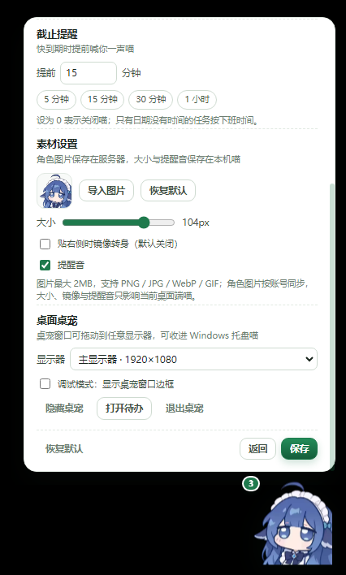

# 桌面端使用说明（Windows 桌宠）

GitStatus 桌面版是把待办桌宠装进 Electron 的 Windows 桌面小程序：桌宠常驻桌面顶层，冒气泡提醒未完成事项，数据、账号、角色素材、提醒设置全部复用同一套后端接口。

> 安装包与仓库**默认不带任何角色图片素材**（只内置一个 SVG 兜底造型），形象需要自己在设置面板的「素材设置 → 导入图片」里导入；参考来源与授权说明见 [8.4 素材设置](#84-素材设置)。

> 本文档面向使用者；实现过程中的决策与踩坑记录见 [桌面版实现说明.md](./桌面版实现说明.md)，接口细节见 [后端API说明.md](./后端API说明.md)。

| 章节 | 内容 |
| --- | --- |
| [一、运行前提](#一运行前提) | 系统、Node、后端要求 |
| [二、安装与启动](#二安装与启动) | 依赖下载、开发启动、首次登录 |
| [三、窗口与架构](#三窗口与架构) | 三窗口分离、职责划分 |
| [四、交互说明](#四交互说明) | 拖拽、点击穿透、气泡、右键菜单、托盘 |
| [五、提醒机制](#五提醒机制) | 服务端事件、本地策略、去重与宽限 |
| [六、后端地址配置](#六后端地址配置) | `serverUrl` 与环境变量 |
| [七、本机持久化数据](#七本机持久化数据) | userData 下的四个状态文件 |
| [八、设置面板](#八设置面板) | 每个配置项的含义与取值范围 |
| [九、打包发布](#九打包发布) | portable 单文件与镜像配置 |
| [十、代码结构](#十代码结构) | 文件职责速查 |
| [十一、调试](#十一调试) | `PET_DEBUG`、边框可视化 |
| [十二、与网页端的差异](#十二与网页端的差异) | 行为对照表 |
| [十三、已知限制与常见问题](#十三已知限制与常见问题) | FAQ |

---

## 一、运行前提

- **操作系统**：Windows 10 / 11（点击穿透依赖 Electron 在 Windows 上的 `setIgnoreMouseEvents`，macOS / Linux 未适配）。
- **Node.js**：≥ 20（后端 `better-sqlite3` 的 engines 要求 `20.x / 22.x / 23.x / 24.x / 25.x`）。
- **后端**：默认地址 `http://localhost:30012`。`serverUrl` 指向本机时，桌面端启动后会**自动检测并按需静默拉起**后台（执行 `desktop/config.json` 里的 `backendCommand`，默认在仓库根目录跑 `npm run dev`，不弹控制台窗口）；指向远程域名/IP 时不会尝试拉起，也不会显示启停菜单项。
- **账号**：需要一个已激活（`status = active`）的 GitStatus 账号；新注册账号默认待管理员审批。

---

## 二、安装与启动

### 2.1 启动后端

在项目根目录：

```powershell
npm install
npm run dev          # 或 npx tsx src/index.ts
```

### 2.2 安装桌面端依赖

在仓库根目录执行（会切到 `desktop/` 安装 Electron 依赖）：

```powershell
npm run desktop:install
```

等价于：

```powershell
cd desktop
npm install
```

首次安装会下载 Electron 运行时（百 MB 量级）。国内网络若拉取超时，`desktop/.npmrc` 已经配好 npmmirror 镜像，正常无需干预；手动排查见 [九、打包发布](#九打包发布)。

### 2.3 启动桌宠

```powershell
npm run desktop
```

或：

```powershell
cd desktop
npm start
```

启动后桌宠出现在**当前显示器工作区右下角**，托盘同时出现图标。


### 2.4 首次登录

1. 未登录时桌宠会自动弹出登录气泡；如果气泡已收起，点桌宠右上角的菜单按钮重新打开面板，或右键桌宠选「桌宠设置」；
2. 点「去登录喵」，会在应用内窗口打开 `<serverUrl>/pages/desktop-login.html`；
3. 登录成功后窗口自动关闭，桌宠立刻拉取当日待办并播报欢迎气泡。

登录令牌保存在 Electron 的 userData 目录（`session.json`），隐藏到托盘后再打开**不需要重复登录**。令牌失效（后端返回 401）时会自动清空本地会话并重新提示登录。

---

## 三、窗口与架构

桌面版由**四个本地窗口 + 三个远程窗口**组成，渲染层全部在 `desktop/renderer/` 下，不再复用网页版桌宠页面。

| 窗口 | 加载内容 | 特性 | 职责 |
| --- | --- | --- | --- |
| 桌宠窗 `petWin` | `renderer/pet.html` | 无边框、透明、置顶（`screen-saver` 层级）、不进任务栏、不可缩放 | 只画桌宠本体与右侧悬浮小按钮 |
| 气泡窗 `bubbleWin` | `renderer/bubble.html` | 同上，尺寸随内容重排 | 承载小气泡 / 完整面板 / 提醒 / 播报四种形态 |
| 设置窗 `settingsWin` | `renderer/settings.html` | 无边框浮窗，宽度 384px | 提醒设置、素材、桌面动作 |
| 登录窗 `loginWin` | `<serverUrl>/pages/desktop-login.html` | 常规窗口 | 走网页端登录流程 |
| 待办窗 `todoWin` | `<serverUrl>/pages/todo.html` | 常规窗口，可复用 | 应用内打开待办页，复用登录态 |
| 对话窗 `chatWin` | `renderer/chat.html` | 无边框透明浮窗，400×560 卡片，可复用 | 双击桌宠开关的内置 AI 助手对话 |
| 完整对话页 `chatPageWin` | `<serverUrl>/pages/chat.html` | 常规窗口，1120×820 | 点浮窗右上角 ↗ 打开，带历史会话侧栏与模型设置 |

关键设计：

- **主进程统一取数与调度**：轮询、提醒判定、角色素材下载都在 `main.js`，窗口只接收 `app:state` / `bubble:render` / `pet:image` 等事件做展示，因此三个窗口状态永远一致。
- **鼠标命中按桌宠小窗矩形判断**，不再采集网页版的命中区块，透明区域直接穿透到桌面。
- **软件合成**：启动时调用 `app.disableHardwareAcceleration()`。透明置顶窗在部分显卡驱动上拖动会闪烁，桌宠窗口很小，软件合成更稳。
- **禁用后台节流**：`disable-background-timer-throttling`、`disable-renderer-backgrounding`、`CalculateNativeWinOcclusion` 等开关保证窗口被遮挡或最小化时轮询与提醒不暂停。

---

## 四、交互说明

### 4.1 拖拽与多显示器

- 按住桌宠可直接从主屏拖到副屏，松手后位置自动保存。
- 拖拽过程**只移动窗口、不改尺寸**（透明窗 resize 会重新合成，高 DPI 下会闪）。
- 拖不出当前显示器的**工作区**（任务栏区域不会覆盖），跨屏以光标所在显示器为准，松手后归属该屏。贴边判定以桌宠的**可视方块（size × size）**为基准，不是包着它的窗口矩形：不靠按钮的那一侧可以完全贴住工作区（窗口四周的 10px 透明内边距允许探出屏幕）；按钮所在的一侧（默认右侧，镜像后在左侧）会多留一个内边距，因为悬停出现的侧边按钮是相对窗口边缘定位的，不留会被屏幕边缘裁掉。
- 首次启动或定位异常时，桌宠默认落在工作区右下角，距边缘 10px。
- 「镜像角色」让桌宠始终水平翻转（默认关）；「贴右侧时镜像转身」是在桌宠中心越过工作区水平中线后自动翻转（默认关），两者同时开启时互相叠加。
- 桌宠一旦翻转，侧边三个小按钮与徽标会沿桌宠中线反射到另一侧；小气泡也优先改到另一侧展开，那一侧放不下时退回另一侧。
- 切换显示器有两个入口：设置面板的「显示器」下拉、托盘右键菜单的「显示器」子菜单（多显示器时才出现），选择后会跳到该屏工作区右下角并且记住。
- 显示器分辨率或缩放比变化后，旧坐标会被丢弃，桌宠回到默认右下角。

### 4.2 点击穿透

主进程按光标位置轮询（`startHoverGuard`）：光标进入桌宠可视矩形才 `setIgnoreMouseEvents(false)` 接收事件，离开立即恢复穿透。所以除了桌宠、气泡、按钮这几块实际像素，其余区域点击都会落到桌面或下层窗口。

### 4.3 桌宠上的按钮

桌宠右上角有一列小按钮（菜单 / 新建 / 待办），**默认隐藏，鼠标移上去才显示**；触屏设备没有 hover，会保持常显。

| 入口 | 行为 |
| --- | --- |
| 左键点桌宠本体 | 切换小气泡（统计摘要），7 秒无操作自动收起 |
| 双击桌宠本体 | 开关 AI 助手对话浮窗（已打开则关闭） |
| 菜单按钮 | 切换完整面板（今日待办列表 + 下一提醒），10 秒自动收起 |
| `+` 按钮 | 应用内打开待办页并直接弹出新建待办弹窗 |
| 右键桌宠 | 弹出原生右键菜单 |

### 4.4 气泡形态与自动收起

| 类型 | 内容 | 宽度 | 自动收起 |
| --- | --- | --- | --- |
| `mini` 小气泡 | 一句话摘要（未完成 / 逾期数量、登录提示、离线提示） | 200px | 7 秒 |
| `panel` 完整面板 | 今日日期、统计、待办预览（最多 3 条）、下一次提醒时间、静音开关 | 322px | 10 秒 |
| `reminder` 提醒 | 提醒正文 + 「稍后提醒」+ 跳转按钮 | 322px | 30 秒 |
| `notice` 播报 | 隐藏/回来、启动时的随机文案 | 200px | 7 秒（告别语不自动收起） |

- 面板最高 560px，且不超过当前工作区高度减 24px。
- 鼠标停留在气泡上时暂停收起并标记为脏，移开后再刷新、重新计时。
- 气泡位置自动避让：优先放桌宠右侧，超出屏幕则翻到左侧 / 上方。

### 4.5 右键菜单与托盘

**桌宠右键菜单**：查看今日待办、打开待办、新建待办、AI 助手、桌宠设置、隐藏桌宠、退出桌宠。

**托盘**：
- 左键单击：显示 / 隐藏桌宠。
- 右键菜单：隐藏（显示）桌宠、显示器（多屏时）、打开待办、AI 助手、桌宠设置、登录 GitStatus（仅未登录时出现）、启动后台（离线时标注未运行）、停止后台、重启后台、重启桌宠、退出桌宠。后台启停三项只在 `serverUrl` 指向本机时出现。
- 鼠标悬停 tooltip 会显示未完成条数，例如 `GitStatus 桌宠 · 还有 3 条待办喵`。

> **隐藏 ≠ 退出**：「隐藏桌宠」、关闭桌宠窗、以及未登录 / 加载中状态下的 `×`，都只是收进托盘，轮询与提醒继续运行；**完整面板右上角的 `×` 只关闭面板**，桌宠与提醒不受影响。彻底退出请用托盘菜单或设置里的「退出桌宠」。退出桌宠不影响后端。

### 4.6 提醒按钮动作

气泡上的按钮由主进程统一处理，支持：打开待办、打开新建待办、打开设置、打开登录、隐藏桌宠、关闭气泡、退出、切换提醒音、稍后提醒（1–120 分钟贪睡）、重新连接、用系统浏览器打开链接。

---

## 五、提醒机制

### 5.1 数据来源

| 定时器 | 间隔 | 做的事 |
| --- | --- | --- |
| 轮询 `POLL_MS` | 25 秒 | 调 `GET /gitstatus/api/todo/widget/summary?since=<上次 now>`，拿到增量 `events`（服务端提醒事件）、`dueSoon`（即将到期）、`stats`、`preview`、`nextReminder`，并同步 `settings` 与角色素材版本 |
| 本地 tick `TICK_MS` | 15 秒 | 检查间隔提醒、上下班提醒（不依赖网络） |

### 5.2 四类提醒

| 类型 | 触发条件 | 文案来源 |
| --- | --- | --- |
| 服务端提醒 | 待办自身设置的提醒时间到点，`events` 中返回 | `copy.makeServerNotice` |
| 截止前提醒 | `dueSoon` 返回的任务，提前量由「截止提醒」设置决定 | `copy.makeDueNotice` |
| 间隔提醒 | 开关打开且 `pending > 0`，距上次触发超过 `intervalMinutes`；可勾选「仅在工作时间内提醒」 | `copy.makeIntervalNotice` |
| 上下班提醒 | 到达上班/下班时间点后的 10 分钟宽限窗口内触发一次，每天每类只触发一次 | `copy.makeWorkStartNotice` / `makeWorkEndNotice` |

### 5.3 去重与排队

- 每条提醒带唯一 `key`，已触发的 key 记入 `reminder-state.json`（最多保留 200 条），重启不会重复轰炸。
- 桌面版长时间未关闭导致间隔超时**不会补发**：超过 2 个间隔直接重置计时基准。
- 提醒进入队列（上限 20 条）依次弹出；正在显示提醒或完整面板、设置窗口打开、桌宠正在拖拽时排队等待。
- 桌宠收进托盘时不排队，改为直接发 **Windows 系统通知**；桌宠窗口异常消失时同样用系统通知兜底。
- 提醒音是否播放由设置面板的「提醒音」开关决定（本机偏好，不上传服务器）。

---

## 六、后端地址配置

默认连接 `http://localhost:30012`，优先级：**环境变量 > 配置文件 > 默认值**。

### 6.1 改配置文件

[desktop/config.json](../desktop/config.json)：

```json
{
  "serverUrl": "http://localhost:30012",
  "backendCwd": "..",
  "backendCommand": "npm run dev"
}
```

- `serverUrl`：后端地址。
- `backendCwd`：后台启动目录，相对 `desktop/` 解析，默认 `..`（仓库根）。打包后 `__dirname` 在 app.asar 内，**必须改成绝对路径**，否则「启动后台」会提示未配置。
- `backendCommand`：后台未运行时执行的启动命令，默认 `npm run dev`。

### 6.2 启动与日志

- **自动拉起**：桌面端启动 1.5 秒后探一次接口，连不上且 `serverUrl` 是本机地址时静默执行 `backendCommand`，最多等 40 秒；超时或失败才会弹通知。
- **静默运行**：不弹控制台窗口；后台独立于桌面端存活，关掉桌宠不会停掉后台。
- **停止 / 重启**：托盘菜单里的这两项会结束占用 `serverUrl` 端口的进程，并连带清掉本仓库的 `nodemon`（否则它会把子进程重新拉起来）。
- **日志**：业务日志由后端自己写到仓库的 `src/output/logs/YYYY-MM-DD.log`；桌面端只把每次拉起的时间与命令记到 `%APPDATA%\<应用目录>\backend.log`。

### 6.3 环境变量临时覆盖

```powershell
$env:GITSTATUS_URL = "http://192.168.1.10:30012"
npm start
```

地址结尾的多余 `/` 会被自动去掉；登录页与待办页地址由该值拼出（`/pages/desktop-login.html`、`/pages/todo.html`）。

后端不可达时，桌宠会在气泡里显示离线提示与当前 `serverUrl`，点「重新连接」立即重试；打开待办页会落到离线页，那里可以直接点「启动后台」拉起本地后端。恢复后自动继续轮询。

---

## 七、本机持久化数据

保存目录为 Electron 的 `app.getPath("userData")`，Windows 下按启动方式取名：

| 启动方式 | 目录 |
| --- | --- |
| 开发模式 `npm run desktop` | `%APPDATA%\gitstatus-pet-desktop\` |
| 打包后的 exe | `%APPDATA%\GitStatusPet\` |

| 文件 | 内容 |
| --- | --- |
| `session.json` | 登录令牌 |
| `preferences.json` | 桌宠大小、是否镜像、是否静音、调试边框 |
| `display-state.json` | 桌宠所在显示器与窗口坐标 |
| `reminder-state.json` | 已触发提醒 key、上次间隔提醒时间、当天上下班提醒状态 |

> 提醒**设置**（间隔、上下班、提前量、角色素材）不存在本机，而是随账号存在服务器；换机器登录后会自动同步回来。删除上述文件相当于恢复出厂，退出桌宠不会删除它们。

---

## 八、设置面板

入口：桌宠菜单按钮 → 设置，或右键桌宠 / 托盘菜单 → 「桌宠设置」。



> 上图是面板滚到下半部分的样子（截止提醒 / 素材设置 / 桌面桌宠），间隔提醒与上下班提醒在面板顶部，见 8.1、8.2。

### 8.1 间隔提醒
| 项 | 说明 | 取值 |
| --- | --- | --- |
| 开关 | 有未完成待办时定时冒泡 | 默认开 |
| 间隔分钟 | 每 N 分钟提醒一次 | 5 – 480，默认 60 |
| 仅在工作时间内提醒 | 用下面的上下班时间界定窗口 | 默认关 |

### 8.2 上下班提醒
| 项 | 说明 | 取值 |
| --- | --- | --- |
| 上班时间 + 开关 | 到点后 10 分钟内提醒剩余数量 | 默认 `09:00`，开 |
| 下班时间 + 开关 | 到点后 10 分钟内提醒剩余与逾期数量 | 默认 `18:00`，开 |

下班时间同时作为「只有日期没有截止时间」任务的截止时刻。校验规则：下班必须晚于上班。

### 8.3 截止提醒
提前 N 分钟提醒（0 – 1440，默认 15），提供 5 分钟 / 15 分钟 / 30 分钟 / 1 小时快捷档；设为 0 表示关闭。

### 8.4 素材设置
| 项 | 存储位置 | 说明 |
| --- | --- | --- |
| 角色图片 | **服务器**（按账号同步） | 支持 PNG / JPG / WebP / GIF，单文件 ≤ 2MB；「恢复默认」删除自定义形象 |
| 大小 | 本机 | 56 – 120px，默认 76px（步进 4） |
| 镜像角色 | 本机 | 角色始终水平翻转，适合朝向相反的图片素材，默认关 |
| 镜像转身 | 本机 | 贴屏幕右侧时水平翻转，默认关；与「镜像角色」同时开启时两者叠加抵消 |
| 提醒音 | 本机 | 关闭后提醒静音 |

> 两个镜像开关都会带动侧边按钮、徽标与小气泡一起沿中线反射到另一侧。

> **素材声明**：桌宠造型与气泡的代码思路参考了 DeepSeek Harness（DSH）的社区插件 [MeteorNOX/DeepSeek-Balance-Whale-Widget](https://github.com/MeteorNOX/DeepSeek-Balance-Whale-Widget)（MIT），本项目只借鉴代码，**仓库与打包产物里都不含它的美术素材**（包括那只「大肥鱼」小鲸鱼娘）。未导入角色图片时，桌宠渲染的是内置的内联 SVG 造型（`desktop/renderer/pet-visual.js`），图片加载失败也会回退到它。

上传非透明底图片时，主进程会自动做**纯色背景抠图**：取四角像素求背景均值，容差 28，从边缘做连通泛洪把匹配的像素 alpha 置 0。若图片本身已有 3 个以上角透明、背景占比低于 2%、像素超过 1600 万，或格式为 GIF（只保留首帧），则跳过处理。

### 8.5 桌面桌宠
显示器下拉、调试模式（显示窗口边框）、「隐藏桌宠 / 打开待办 / 退出桌宠」三个动作。

底部按钮：**恢复默认**（仅重置提醒设置草稿）、**返回**、**保存**（写回服务器）。

---

## 九、打包发布

```powershell
cd desktop
npm run dist
```

产物在 `desktop/dist/`，为 Windows **portable 单文件** exe（x64），当前版本文件名形如 `GitStatusPet 0.1.0.exe`（约 70MB，内含 Electron 运行时），双击即可运行，无需安装。`dist/win-unpacked/` 是打包中间产物，可忽略。

配置要点（见 [desktop/package.json](../desktop/package.json)）：
- `build.files`：`main.js`、`preload.js`、`lib/**`、`renderer/**`、`offline.html`、`config.json`、`tray.png`；
- `build.directories.output`：`dist`；
- `build.electronDist`：`node_modules/electron/dist`，复用已下载的运行时避免二次拉取。

网络受限时确认 `desktop/.npmrc` 生效：

```ini
electron_mirror=https://npmmirror.com/mirrors/electron/
electron_builder_binaries_mirror=https://npmmirror.com/mirrors/electron-builder-binaries/
```

> 打包机需要能访问 npmmirror；exe 内置的 `serverUrl` 取自打包时的 `desktop/config.json`，发给别人用记得先改成对方能访问的后端地址。

---

## 十、代码结构

| 文件 | 作用 |
| --- | --- |
| `desktop/main.js` | 主进程：窗口创建与定位、点击穿透守卫、置顶守卫、拖拽、多显示器、托盘、提醒调度与队列、IPC 注册、素材同步 |
| `desktop/preload.js` | `contextBridge` 暴露 `desktopApi` 白名单（状态订阅、拖拽、气泡控制、动作、设置窗操作） |
| `desktop/lib/api.js` | 后端调用封装：`summary(since)`、`settings`、`saveSettings`、`uploadPetImage`、`deletePetImage`、`fetchPetImageDataUrl`、`quickStartProjects`，以及纯色背景抠图与网络异常标记 |
| `desktop/lib/store.js` | userData 下 JSON 状态文件的读写（读失败回退默认值） |
| `desktop/lib/copy.js` | 所有面向用户的文案生成与提醒去重 key |
| `desktop/renderer/pet.html·js·css` | 桌宠窗渲染、动画、hover 按钮、拖拽事件 |
| `desktop/renderer/bubble.html·js·css` | 气泡窗四种形态的渲染与按钮动作 |
| `desktop/renderer/settings.html·js·css` | 设置面板（表单由 JS 动态构建） |
| `desktop/renderer/pet-visual.js` | 桌宠形象渲染（图片 + 容器），设置面板缩略图复用 |
| `desktop/offline.html` | 远程页面加载失败时的重试页，可直接「启动后台」拉起本地后端 |
| `desktop/config.json` | `serverUrl` 与「启动后台」的 `backendCwd` / `backendCommand` |
| `desktop/tray.png` | 托盘图标 |
| `desktop/.npmrc` | Electron 与 electron-builder 镜像 |

渲染进程与主进程通过固定几个 IPC 通道通信：`app:state`、`pet:image`、`pet:flip`、`pet:alert`、`bubble:render`、`bubble:placement`、`bubble:shown`、`bubble:hidden`、`settings:shown`。

---

## 十一、调试

```powershell
$env:PET_DEBUG = "1"
npm start
```

日志写入 `desktop/pet-debug.log`，包含启动时的 userData 路径、窗口位置保存/恢复、渲染进程崩溃、显示器变化等。

无边框透明窗不容易看清边界，可在设置面板勾选「调试模式：显示桌宠窗口边框」，直接看到桌宠窗与气泡窗的实际矩形，判断是穿透问题还是定位问题。

---

## 十二、与网页端的差异

| 行为 | 桌面版 | 网页版 |
| --- | --- | --- |
| 「+」新建待办 | 应用内窗口打开待办页并弹新建框 | 跳转 `todo.html?add=1` |
| 「打开待办」入口 | 一律应用内窗口，复用登录态 | 系统标签页 |
| 提醒触发时机 | 主进程 15s tick + 25s 轮询，窗口被遮挡也照常跑 | 依赖页面处于打开状态 |
| 隐藏后 | 收进托盘，提醒转 Windows 系统通知 | 页面关闭即停止 |
| 桌宠大小 / 镜像 / 提醒音 | 存本机 | 存浏览器本地 |
| 角色图片与提醒设置 | 存服务器，按账号同步 | 同左 |
| 待办页内嵌桌宠 | 与桌面覆盖层互不影响 | 默认隐藏，可在账号信息卡片「待办页桌宠」开关打开 |

---

## 十三、已知限制与常见问题

| 现象 | 原因与处理 |
| --- | --- |
| 启动后没有桌宠 | 检查是否被隐藏到托盘（左键单击托盘图标恢复），或坐标落在已拔掉的老副屏上——用托盘「显示器」子菜单重新定位 |
| 气泡显示「后台还没有启动喵」 | 后端未运行或 `serverUrl` 不对，改配置后点「重新连接」 |
| 一直提示未登录 | 令牌过期或账号被禁用；重新登录即可（服务器上删除/禁用账号需要管理员操作，**第一个注册的用户自动成为管理员**） |
| 拖动闪烁 / 边缘残影 | 已在启动时关闭硬件加速；若仍闪烁，检查是否开启了系统的窗口透明效果或第三方桌面美化软件 |
| 高 DPI 多屏下半像素偏移 | 坐标会按目标显示器 scaleFactor 对齐（125% / 150% 不再落在半像素）；改分辨率或缩放后旧坐标会被丢弃并回到右下角 |
| 收进托盘后提醒变系统通知 | 设计如此，避免恢复显示时一次性弹出一堆积压提醒 |
| 开机自启 | 当前版本未提供，需要自行用任务计划程序或启动目录放置快捷方式 |
| macOS / Linux | 未适配，`setIgnoreMouseEvents` 行为与 Windows 不同 |

---

## 相关文档

- [主 README](../README.md) — 安装启动总览
- [后端API说明.md](./后端API说明.md) — 桌宠挂件接口（第九节）
- [桌面版实现说明.md](./桌面版实现说明.md) — 实现过程与决策记录
- [文档索引](./README.md)
