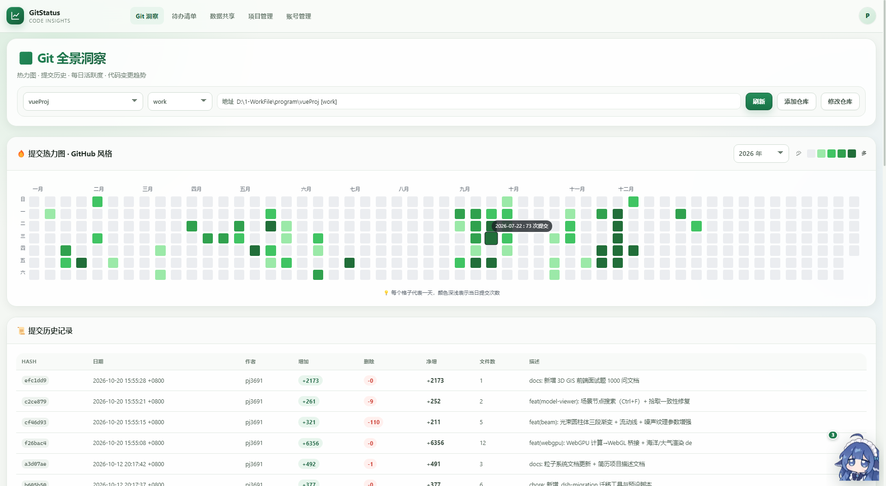

# Git 全景洞察 · `/pages/index.html`

> 根路径 `/` 自动跳到这一页。用来把一个**本地 Git 仓库**的提交历史可视化：热力图、提交明细、代码变更趋势、每日活跃表。
>
> 通用部分（导航、登录、角色、页面桌宠）见 [通用交互与登录](通用交互与登录.md)。

---

## 一、权限与登录

| 情形 | 页面表现 |
|---|---|
| 未登录 | 盖一层登录遮罩（标题 `登录`，只有用户名 + 密码 + `登录` 按钮），仓库数据需要登录后才加载 |
| 只读账号 | 可以正常看数据，但 `添加仓库`、`修改仓库`、`刷新`、编辑面板的 `确定` 四个按钮**全部禁用**，悬停提示「当前账号为只读权限，无法修改仓库」 |
| 读写 / 管理员 | 全部功能可用 |

## 二、仓库控制区

页面标题「📊 Git 全景洞察」下方一排控件：

| 控件 | 说明 |
|---|---|
| 仓库下拉 | 列出已登记的仓库（显示名称）。没有仓库时显示占位项 `请选择仓库`；页面默认选中的是列表里的**第一个**仓库 |
| 分支下拉 | 当前仓库的分支列表；仓库没有分支信息时显示 `无分支`，此时所有统计基于后端返回的全部提交。选中项默认取仓库的默认分支 |
| 地址显示 | 形如 `D:/projects/my-repo [main]`，即「仓库地址 + 当前分支」；未选仓库时显示 `-` |
| `刷新` | 让后端重新扫描该仓库的 git 历史并回写数据；执行期间按钮文案变 `刷新中...` |
| `添加仓库` / `修改仓库` | 展开下方的编辑面板（见第三节） |

> **新登记的仓库必须先点一次「刷新」**，否则库里还没有提交数据，四张图都会是空的。

## 三、新增 / 修改仓库面板

点 `添加仓库` 或 `修改仓库` 后在控制区下方展开，标题随模式变为 `新增仓库` 或 `修改仓库`：

| 字段 | 说明 |
|---|---|
| 仓库名称 | 占位「输入仓库名称」；留空提交会提示「请输入仓库名称」 |
| 仓库地址 | 占位「输入仓库地址，例如 D:/xxxx/xxxx/xxxx」，填**后端所在机器上的本地路径**（不是远程 URL）；留空提示「请输入仓库地址」 |
| 默认分支 | 该仓库分支列表，供新增/修改时挑选；没有分支数据时只给出 `HEAD` |
| `确定新增` / `确定修改` | 提交期间文案变 `新增中...` / `修改中...` |
| `取消` | 收起面板 |

`修改仓库` 是"改选中项"：若仓库下拉里还没选中仓库，会提示「请先在下拉框选择仓库」。

## 四、数据是怎么来的

```
后端 git log 扫描（点「刷新」触发）
   └─ 按分支存成 commitsByBranch: { "main": [提交…], "dev": [提交…] }
        └─ 前端选中分支后取该数组 → 聚合每日数据 → 渲染四张卡片
```

- 切换分支会**重置分页到第 1 页**并重绘全部图表，因此各分支的统计互相独立。
- 提交数组沿用后端返回的顺序（新 → 旧），表格不再二次排序；每日统计表则显式按日期倒序。
- 每日聚合规则：按提交日期（只取日期部分）累加 `提交次数 / 增加行 / 删除行`，净增 = 增加 − 删除。
- 源码里还留着一段未使用的 `generateFullMockCommits()`（早期开发用的假数据生成器），**它不参与页面渲染**，页面上所有数字都来自真实仓库。

## 五、四张卡片

### 5.1 🔥 提交热力图 · GitHub 风格

| 元素 | 说明 |
|---|---|
| 年份下拉 | 只列出数据中真实出现过的年份，倒序排列（`2026 年`…），默认渲染最新一年；无数据时显示 `暂无年份` |
| 网格 | 7 行（`日 一 二 三 四 五 六`，自上而下）× N 列（周），格子边长随容器宽度动态计算，最小 8px |
| 月份标签 | 与周列对齐，取每月 1 号所在列，显示中文 `一月`…`十二月` |
| 颜色分档 | 0 次 `#ebedf0` · 1–2 次 `#9be9a8` · 3–5 次 `#40c463` · 6–9 次 `#30a14e` · ≥10 次 `#216e39`，图例为「少 → 多」五格 |
| 悬停格子 | 显示 tooltip `日期 : N 次提交`；年初对齐用的填充格没有日期，显示 `无数据` |
| 底部说明 | 「💡 每个格子代表一天，颜色深浅表示当日提交次数」 |

### 5.2 📜 提交历史记录

8 列分页表：`Hash` · `日期` · `作者` · `增加` · `删除` · `净增` · `文件数` · `描述`。

- Hash 只显示前 7 位，悬停 tooltip 是完整 40 位。
- 增加/删除/净增带正负配色（净增为正绿、为负红）。
- 描述截断到 45 个字符，悬停可看完整提交信息。
- 每页 `10 / 15 / 20 / 30` 条（默认 15）；分页条为 `◀ 上一页` + 页码 + `下一页 ▶`，只有一页时显示 `共1页`；空结果显示「暂无记录」。

### 5.3 📈 代码变更趋势曲线

- Chart.js 折线，两条系列：`新增代码行数 (+)`、`删除代码行数 (-)`，纵轴标题 `代码行数`。脚本用仓库内的本地 vendor，**不联网加载 CDN**。
- 交互：**滚轮缩放**（只缩放 x 轴）、**按住横向拖拽平移**、点击图例可隐藏/恢复某条系列；`净增` 不进图，只在表格里看。
- **极端值剔除**：单日增加或删除行数超过 15000 行的日期不画进曲线（避免一次依赖打包或生成文件写入万行时把整条曲线压平）。这些日期仍然出现在提交历史与每日统计表里。
- 图下三个统计药丸：`✅ 总提交次数`、`➕ 总增加行`、`➖ 总删除行`，口径为当前所选分支的全量提交。

### 5.4 📅 每日提交统计 · 类 GitHub 活跃表

6 列：`日期 (UTC+8)` · `提交次数` · `总增加` · `总删除` · `净增行数` · `活跃指数`。

- **活跃指数 = 提交次数 × 2 + ⌊|净增行数| / 12⌋**，显示为 `🔥 N`。它只用来横向比较哪天更"忙"，不是任何物理量。
- 每页 `10 / 15 / 20 / 30` 天（默认 15 天），分页样式与提交表一致；无数据显示「无数据」。

## 六、接口对应

| 页面动作 | 接口 |
|---|---|
| 登录 / 取当前用户 | `POST /gitstatus/api/auth/login`、`GET /gitstatus/api/auth/me` |
| 仓库列表 | `GET /gitstatus/api/repos` |
| 单个仓库 + 提交数据 | `GET /gitstatus/api/repos?id={id}` |
| 新增 / 修改仓库 | `POST /gitstatus/api/repos`、`PUT /gitstatus/api/repos/{id}` |
| 刷新仓库 | `POST /gitstatus/api/repos/{id}/refresh` |

参数表与响应示例见 [后端 API 说明 · 四、仓库管理 API](../后端API说明.md#四仓库管理-api)，数据结构见 [Repo / GitCommit](../后端API说明.md#十二数据结构汇总)。

## 七、常见问题

| 现象 | 原因与处理 |
|---|---|
| 四张图全空 | 新仓库还没扫描 → 选中它后点 `刷新`；或该分支确实没有提交 |
| 只有部分分支有数据 | 数据按分支分别登记，切分支下拉确认；某分支为空说明该分支还没扫描过 |
| 按钮灰掉不能点 | 当前是只读账号（提示「当前账号为只读权限，无法修改仓库」），换读写账号或让管理员调整角色 |
| 提示 `刷新失败: 500` / `读取仓库数据失败` | 仓库路径不存在、不是 git 仓库、或 `.git` 无权限读；核对「仓库地址」是否为后端机器上的绝对路径 |
| 提示 `请先在下拉框选择仓库` | 点 `修改仓库` 时下拉里没有选中项 |
| 趋势图缺了某几天 | 那几天的增删行数超过 15000，被极端值剔除（见 5.3），明细仍在表格里 |
| 提交日期与本地感受差一天 | 统计按 `UTC+8` 口径切日 |



## 相关文档

- [通用交互与登录](通用交互与登录.md) · [后端 API 说明](../后端API说明.md) · [文档索引](../README.md)
