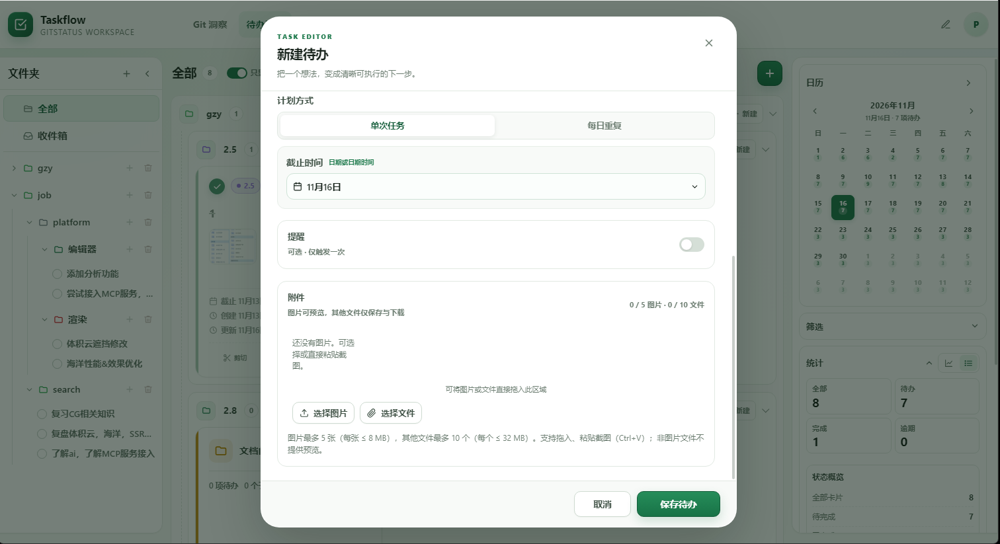
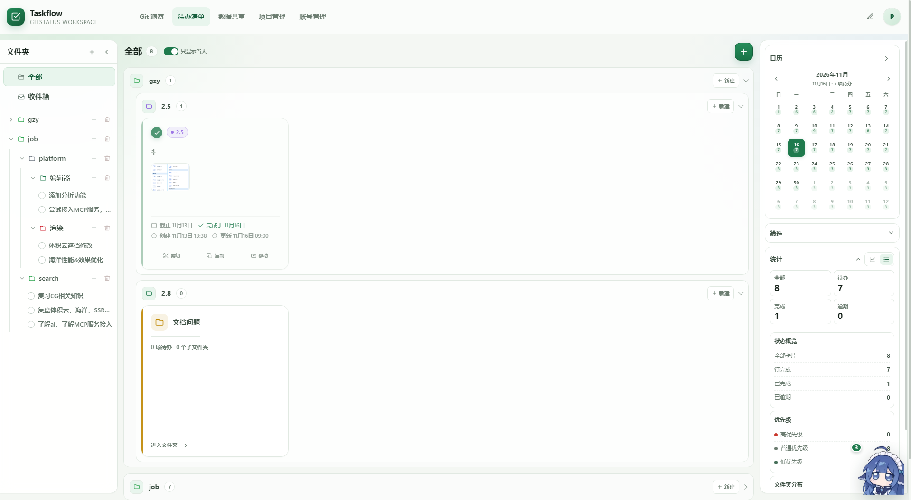

# 待办清单 · `/pages/todo.html`

> 这一页是系统的主体：多级文件夹 + 卡片看板 + 日历筛选统计 + 提醒 + 图片与文件附件，并且是**全站唯一的注册入口**。
>
> 通用部分见 [通用交互与登录](通用交互与登录.md)；把文件夹授权给别人看[数据共享](数据共享.md)。

---

## 一、快速上手

1. 打开页面 → 未登录时先看到登录面板（`登录` / `创建账号` 两个页签）。全新环境**第一个注册的账号自动成为管理员**并立即可用。
2. 登录后点看板右上方的 `＋`（新建待办）建第一条任务。
3. 想用文件夹归类：左侧栏顶部 `＋`（新建文件夹），或在某个文件夹节点上点 `＋` 选「新建子文件夹」。
4. 想让桌宠盯进度：右上头像 → 账号信息 → 打开「页面桌宠」（见[通用交互 · 页面桌宠](通用交互与登录.md#五页面桌宠网页挂件)）。

## 二、三栏布局

| 栏 | 内容 | 收起方式 |
|---|---|---|
| 左：**文件夹** | 文件夹树 + 每个文件夹内展开的任务 | 头部 `‹` 收起成一条竖栏，点竖栏上的文件夹图标恢复 |
| 中：**看板** | 标题（当前视图名 + 结果数）、`只显示当天` 开关、`＋` 新建、剪贴板提示条、卡片墙、分页 | — |
| 右：**日历 · 筛选 · 统计** | 三个模块，各自可折叠 | 模块头 `‹` 收起整栏成竖条；筛选与统计还能单独折叠 |

窄屏（手机）下左右栏默认隐藏，看板左上和右上各出现一个图标按钮：`打开文件夹`、`打开筛选`，以抽屉方式弹出并带遮罩。

栏位的收起/展开状态记忆在本机 localStorage（`gitstatus_todo_left_collapsed`、`gitstatus_todo_right_collapsed`），详见[第十节](#十本机记忆的判断项)。

## 三、左侧文件夹树

### 3.1 结构

```
全部                 ← 文件夹分组卡片墙（默认视图）
├─ 工作              ← 多级文件夹，可继续嵌套
│   ├─ 需求
│   └─ 上线
├─ 生活
└─ 收件箱            ← 未归入任何文件夹的任务
```

- 节点前的三角展开后**直接列出该文件夹内的任务**（每行一个任务，悬停显示「标题 · 可拖动」）；没有子内容时三角是禁用态。
- 悬停节点出现：`＋`（菜单里两项：`新建待办` / `新建子文件夹`）和 `删除`（垃圾桶图标）。共享来的只读文件夹不出现这两个按钮，试图创建子文件夹会得到「共享文件夹中不能创建子文件夹」。
- 剪贴板里有卡片时，节点的 `粘贴` 按钮会出现（只读共享文件夹不会出现）。

### 3.2 选中与多选

| 操作 | 结果 |
|---|---|
| 单击文件夹 | 看板切到该文件夹视图，标题跟着变 |
| **Ctrl / ⌘ + 单击** | 加选或取消选中，看板标题区出现「已选 N 个」计数 |
| **Shift + 单击** | 从上次锚点起到当前项**连续范围**选中 |
| 点 `全部` 或 `收件箱` | 清空多选，回到单一视图 |

### 3.3 拖拽

| 拖什么 | 拖到哪 | 结果 |
|---|---|---|
| 树上的文件夹节点 | 另一个文件夹节点 | 变成它的子文件夹；**多选状态下拖动会把整批选中项一起搬走**（提示「已移动 N 个文件夹」/「已移动 N 个文件夹，M 个失败」） |
| 树上的文件夹节点 | `全部` 节点 | 移动到根目录（该节点提示语：「全部 · 文件夹可拖入此处移至根目录」） |
| 看板上的任务卡片 | 树里的文件夹节点 / 看板里的文件夹分区 | 移动到该文件夹 |
| 看板上的任务卡片 | 展开节点里的另一个任务 | 归到那个任务所在的文件夹 |

保护规则：不能把文件夹移动到自身或自己的子孙下（提示「不能把文件夹移动到自身或其子文件夹中。」），已在目标位置时提示「文件夹已在该位置。」。只读共享的卡片不可拖动。

## 四、看板与卡片

### 4.1 看板

- 视图为 `全部` / `收件箱` 时，卡片按**文件夹分区**铺开；每个分区头部是图标 + 名称 + 该分区操作按钮（`粘贴`、`新建`），点名称或图标即进入该文件夹。
- 分区可折叠（点头部），折叠状态记在本机（`gitstatus_todo_collapsed_sections_v1`）。
- 空文件夹显示可放置的「空文件夹」占位块，收件箱空时显示「收件箱为空」，可以直接往里拖卡片。
- 每页 `24 / 48 / 96` 条（默认 24），分页为 `第 N / M 页` + 上一页/下一页 + 页码。
- 没有结果时显示「无匹配卡片」并给 `重置`（清筛选）与 `新建`；服务不可用时显示「请检查服务和网络连接。」

### 4.2 卡片上能看到什么

| 元素 | 含义 |
|---|---|
| 左侧圆圈 | 完成 / 取消完成开关（已完成的卡片整卡变淡） |
| 徽标 | 优先级（高/普通/低）、分类、`共享 · 某用户`（只读时追加「· 只读」）、`已完成`、`已逾期`、`当日不生效` / `所选日期不生效` |
| 标题 + 描述摘要 | 描述为空时不占位 |
| 缩略图 | 图片附件的缩略图，超过显示数量时出现 `+N`；点击进全屏预览 |
| 附件行 | 非图片文件（详情里可下载 / 用系统程序打开） |
| meta 行 | `每日 · 开始日 至 结束日` 或 `每日 · 长期`、`截止 M月D日 HH:mm`（逾期变红并写「已逾期 · …」）、`无截止日期`、`提醒 每日 HH:mm` 或提醒时间、`创建 …`、`更新 …`、`已完成 …` / `完成于 …` |
| 悬停出现 | `剪切`、`复制`、`移动` 三个小按钮 |

### 4.3 卡片操作

| 动作 | 行为 |
|---|---|
| 点卡片 | 打开详情（可编辑、删除、完成/恢复） |
| 点圆圈 | 切换完成状态。完成记录**按日期落**（同一任务在同一天只记一次），提示「完成一件，继续保持节奏。」或「已恢复为待完成。」 |
| `编辑` | 打开预填的编辑弹窗，按钮文案变 `保存修改` |
| `删除` | 二次确认：「"标题"将被移入已删除状态，并同时停用提醒。此操作无法在页面上撤销。」→ **软删除**，列表不再出现，提醒同时停用 |
| `移动` | 弹出「移动卡片」目标文件夹选择框（标出「当前」所在项，共享任务显示"某用户 的收件箱"） |
| `剪切` / `复制` | 先放进页面内的剪贴板：看板上方出现提示条「已剪切卡片，请选择目标文件夹粘贴。」（或「已复制…」），右侧带 `取消`。随后到树上/分区上的 `粘贴` 按钮落位 |
| 拖拽 | 直接拖到文件夹节点或分区即可移动 |

复制是**真复制**：连图片、文件、提醒一起带上（已过期的单次提醒不会复制，会提示「原单次提醒时间已过，未复制提醒」）。剪切后粘贴等于移动，复制后粘贴得到新任务。

## 五、新建 / 编辑弹窗

标题「新建待办」（副文案「把一个想法，变成清晰可执行的下一步。」）；编辑时是「编辑待办」（「调整计划、标签或附件，保存后立即同步。」），按钮 `保存待办` / `保存修改`。

| 字段 | 规则 |
|---|---|
| 任务标题 * | 必填，≤ 200 字符；占位「例如：完成本周项目复盘」 |
| 描述 | 可选，≤ 5000 字符 |
| 分类 | 下拉选择归属文件夹；空值即 `收件箱（无分类）`。下拉旁有 `管理分类与标签` 入口 |
| 优先级 | 分段选择：`低` / `普通`（默认）/ `高` |
| 标签 | 多选标签芯片。所有者还没有标签时显示「该数据所有者还没有标签。」；共享来的标签显示成「某用户 / 标签名」 |
| 计划方式 | `单次任务`（默认）/ `每日重复` |
| 截止时间 | 单次任务专用：**日期或日期时间**二选一（用日期选择器，只选日期=当天有效，选到分钟=精确截止）。想填时间必须先选日期，否则提示「选择截止时间前，请先选择截止日期。」 |
| 重复开始日期 * | 每日任务的必填项，不填提示「每日重复任务需要选择开始日期。」 |
| 重复结束日期 | 可选；留空即「长期」。早于开始日期提示「重复结束日期不能早于开始日期。」 |
| 提醒 | 开关（默认关）。单次任务显示「可选 · 仅触发一次」，选 `提醒时间`（精确到分钟）；每日任务显示「可选 · 每日固定时间提醒」，选 `每日提醒时间`（默认 09:00）。页内说明：「单次提醒只在未来时间触发；每日任务在重复日期范围内每日提醒。」 |
| 附件 | 见第七节 |

保存后的提示：`待办已创建。` / `待办已更新。`；若任务保存成功但附件或提醒没存上，会追加告警（「附件上传失败：…」「提醒设置失败：…」），这样不会因为附件问题丢掉正文。

### 5.1 提醒相关的校验

| 提示 | 触发条件 |
|---|---|
| 单次提醒时间必须晚于当前时间。 | 选了一个过去的时刻 |
| 请选择单次提醒时间。 / 请选择每日提醒时间。 | 打开了提醒开关却没填时间 |
| 提醒类型需要与任务计划方式一致 | 每日任务配了单次提醒（或反之）——后端会直接拒绝 |
| 已完成的单次任务不能设置提醒 | 给已完成的一次性任务补提醒 |
| 这个每日任务已没有可用的未来提醒时间 | 每日任务的重复区间已经结束 |

提醒与任务是一对一（一个任务最多一条提醒），并且**只按任务 ID 关联**：任务被复制或迁移时提醒随之走，任务被软删除时提醒同时停用。

## 六、日期与"当天"的语义

这是本页最容易困惑的地方。

- 页面顶部看板标题旁的 `只显示当天` 开关（默认**开**）：开启时看板只列「选中那一天该看到的任务」，关闭时列出符合其他筛选条件的全部任务。
- **"某天是否可见"由前后端同一套规则计算**（`isTodoVisibleOnDate`）：
  - 单次任务：有截止日期时按截止日期；无截止日期时按创建日之后的区间展示。
  - 每日任务：落在 `重复开始日期 ~ 重复结束日期`（无结束日期=长期）之内才生效；不在区间内时卡片显示 `当日不生效`，圆圈按钮禁用并提示「所选日期不在这个每日任务的重复区间内」。
- 右侧日历每格下方的小红点/计数就是**按上面这套规则算出的"当天可见任务数"**，和看板口径完全一致（关掉「只显示当天」后两者才不再同集合）。
- 完成记录按日期保存，所以"每日任务"可以做到"今天勾掉、明天重新出现"。
- 点日历某一天 = 把选中日期切到那天；`重置` 会把选中日期拉回今天并重新打开 `只显示当天`。

### 6.1 日期选择器（所有日期输入共用）

| 模式 | 用途 | 控件 |
|---|---|---|
| `单日` | 只看某一天（筛选用） | 月历点选 |
| `日期时间` | 精确到分钟的截止 / 提醒 | 月历点选 + `开始` 时间（步长 1 分钟） |
| `范围` | 创建时间、截止日期区间的筛选 | 依次点起止两天，可再填 `开始` / `结束` 时间 |

底部按钮：`当天`（日期时间模式下为 `此刻`）、`清除`、`取消`、`确定`；顶部有 `上个月` / `下个月`。每格悬停可看到「M月D日，N 条待办」。起止顺序颠倒会提示「创建开始时间不能晚于结束时间。」

## 七、附件

| 类别 | 限制 | 备注 |
|---|---|---|
| 图片 | 最多 **5 张**，每张 ≤ **8 MB** | 只接受 JPEG、PNG、GIF、WebP、BMP、AVIF |
| 其他文件 | 最多 **10 个**，每个 ≤ **32 MB** | 任意类型 |

- 三种添加方式：`选择图片` / `选择文件` 按钮、**把文件拖进虚线区域**（提示「可将图片或文件直接拖入此区域」）、**Ctrl+V 粘贴截图**（成功提示「已从剪贴板添加 N 张图片。」）。
- 计数条实时显示 `N / 5 图片 · M / 10 文件`；超限提示「最多只能添加 5 张图片」「xxx 超过 8 MB」「xxx 不是支持的图片格式」「最多只能添加 10 个文件」「xxx 超过 32 MB」。
- 待上传的文件显示「大小 · 待上传」，可点 `移除图片 xxx` / `移除附件 xxx` 撤下；已保存的卡片上图片直接预览，非图片文件只有列表行。
- 非图片文件的三个入口（详情区）：`用系统默认程序打开`、`在浏览器中打开`、`下载`。
  - 用系统程序打开**仅限本机访问后端**，远程会提示「仅能在运行服务的电脑上直接打开，其他设备请预览或下载」。
  - 浏览器预览被拦截时提示「若浏览器拦截了新窗口，请使用下载按钮。」；类型不支持预览时提示「该文件类型不支持浏览器预览，已开始下载。」
- 图片存后端磁盘（按用户 ID 分目录），元数据入库；具体接口见[后端 API · 七、待办附件 API](../后端API说明.md#七待办附件-api)。

### 7.1 图片全屏预览

点卡片或详情里的图片进入：

- 滚轮缩放（**倍率范围 1×–6×**）、按住拖拽平移、双击在 1× 与 2× 之间切换；
- 键盘：`+` / `=` 放大 1.4×、`-` / `_` 缩小、`0` 或 `适应窗口` 按钮恢复；
- 触屏双指捏合缩放；`Esc` 优先关闭预览（其次关日期选择器、再次关闭最上层弹窗）。

新建 / 编辑弹窗的实际样式：



## 八、右侧栏：日历 · 筛选 · 统计

### 8.1 筛选

| 条件 | 取值 |
|---|---|
| 完成状态 | `全部` / `待办` / `完成` |
| 关键词 | 服务端匹配**任务标题或描述**（不区分大小写），右侧 `×` 清空 |
| 创建时间 | 日期选择器：单日 / 范围 |
| 截止日期 | 日期选择器：单日 / 范围 |
| 标签 | 全部标签 / 某个标签（含共享数据的标签） |
| 类型 | `单次` / `每日` |
| 超时状态 | `已超时` |
| `重置` | 清空以上全部，并把选中日期拉回今天、重新打开 `只显示当天` |

筛选面板本身可以折叠（默认折叠，点头部 `筛选` 展开）。

### 8.2 统计

- 四个数字：`全部` / `待办` / `完成` / `逾期`，口径是**当前筛选结果**，不是全库。
- 图表模式：完成率环形（中间大号百分数 + 「完成」）、`优先级` 条形分布、`文件夹` 条形分布。
- 列表模式：同样的数字以紧凑列表呈现（头部两个图标按钮 `图表` / `列表` 切换，选择记在本机）。
- 当前筛选下没有任务时显示「当前筛选下还没有任务。」

## 九、管理分类与标签

入口有两处：看板顶部的 `管理分类与标签` 图标按钮、新建弹窗里的同名链接。**只读账号点它会得到「只读账号无法管理分类与标签」**。

| 对象 | 能做 | 约束 |
|---|---|---|
| 分类（即文件夹） | 输入名称 + 颜色 + `父级分类` 后 `添加`；行内改名、改色、换父级、删除 | 名称非空且 ≤ 80 字符；同级不能同名；不能以自身作父级，也不能移到自己的子分类下；**删除前必须既没有子分类也没有未删除任务**（提示「分类"X"必须没有子分类和未删除任务才能删除。」） |
| 标签 | 输入名称 + 颜色后 `添加标签`；行内改名、改色、删除 | 同名标签会被拒（「已存在同名标签」）；删除标签只是从任务上摘掉标记，任务本身保留（确认文案已写明） |

列表为空时的引导文案分别是「还没有分类。上方输入名称即可创建第一个分类。」和「还没有标签。标签可以跨分类标记任务。」

## 十、本机记忆的判断项

| localStorage 键 | 作用 |
|---|---|
| `gitstatus_todo_day_only` | `只显示当天` 开关 |
| `gitstatus_todo_left_collapsed` / `gitstatus_todo_right_collapsed` | 左右栏收起状态 |
| `gitstatus_todo_stats_style` / `gitstatus_todo_stats_panel_collapsed` | 统计呈现方式与折叠 |
| `gitstatus_todo_creation_mode` / `gitstatus_todo_due_mode` | 两个日期筛选记住用「按日」还是「按范围」 |
| `gitstatus_todo_collapsed_sections_v1` | 看板里哪些文件夹分组是收起的 |

这些都不上传服务器，换浏览器/换机器不会带过去（与桌宠的提醒设置不同，后者跟账号走）。

## 十一、键盘与无障碍要点

- 弹窗打开时 `Tab` 被限制在弹窗内的可聚焦元素上（循环），`Esc` 按「图片预览 → 日期选择器 → 最上层弹窗 → 移动端抽屉」的顺序逐层关闭。
- 卡片本身可聚焦（`Tab` 可达），`aria-label` 形如「查看详情：任务标题」；圆圈按钮的无障碍名是「标记完成 任务标题」/「取消完成 任务标题」。
- 看板区域带 `aria-live="polite"` 与 `aria-busy`，加载时读屏能感知。
- 只读共享造成的禁用都会在 `title` 里写明原因（如「只读共享，无法编辑」）。

## 十二、接口对应

| 动作 | 接口段 |
|---|---|
| 文件夹（分类）增删改查、排序 | [后端 API · 六、待办 API → 1. 文件夹](../后端API说明.md#六待办-api) |
| 标签 | [同上 → 2. 标签](../后端API说明.md#六待办-api) |
| 任务的增删改查、完成、筛选、移动、复制 | [同上 → 3. 任务](../后端API说明.md#六待办-api) |
| 图片与文件的上传/下载/打开/删除 | [七、待办附件 API](../后端API说明.md#七待办附件-api) |
| 提醒设置（桌宠用） | [九、桌宠挂件 API](../后端API说明.md#九桌宠挂件-api) |

## 十三、常见问题

| 现象 | 原因与处理 |
|---|---|
| 今天的一条任务不见了 | 它的可见区间不含今天（每日任务区间已结束 / 截止日期不是今天）→ 关掉 `只显示当天` 核对 |
| 圆圈点不动 | 卡片带 `当日不生效`（所选日期不在重复区间），或这是只读共享的任务 |
| 粘贴按钮不出现 | 剪贴板为空（先 `剪切`/`复制` 一张卡片），或目标文件夹是只读共享 |
| 删不掉某个文件夹 | 里面还有子文件夹或未删除的任务，先移走或删掉 |
| 附件上传后没反应 | 看保存成功的提示尾部有没有「附件上传失败：…」告警；大文件受 8 MB / 32 MB 限制 |
| 「用系统默认程序打开」灰掉 | 你不是从后端那台机器访问页面（本机限定能力） |
| 提醒一直没响 | 单次提醒必须晚于当前时间；每日提醒只在重复区间内触发；桌宠需处于显示状态或桌面版在运行 |



## 相关文档

- [通用交互与登录](通用交互与登录.md) · [数据共享](数据共享.md) · [后端 API 说明](../后端API说明.md) · [文档索引](../README.md)
