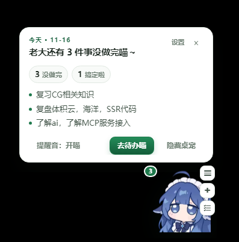

# 通用交互与登录

> 适用于所有网页页面的公共部分：顶部导航、账号信息卡片、登录与注册、角色权限、页面桌宠，以及各页面写入浏览器本地存储的键位。
>
> 各业务页面的专门说明：[Git 全景洞察](Git全景洞察.md) · [待办清单](待办清单.md) · [项目管理](项目管理.md) · [数据共享](数据共享.md) · [账号管理](账号管理.md)

---

## 一、顶部导航与品牌区

每个业务页头部结构相同（`账号管理` 之外的四项恒定）：

| 位置 | 内容 | 说明 |
|---|---|---|
| 左侧品牌 | `Taskflow` / `GitStatus Workspace` + 图标 | 点击回到 Git 洞察页（`/pages/index.html`） |
| 主导航 | `Git 洞察` · `待办清单` · `数据共享` · `项目管理` | 当前页会加 `active` 样式并带 `aria-current="page"` |
| 主导航末项 | `账号管理` | **默认 `hidden`，只有管理员角色才渲染出来**；非管理员即使手输 URL 也会被拦（见[账号管理](账号管理.md)） |
| 右侧操作 | 待办页额外有 `管理分类与标签` 图标按钮 | 其余页面右侧只有头像 |
| 最右头像 | 圆形头像（无用户名时显示 `?`） | 点开账号信息卡片 |

## 二、账号信息卡片

点头像展开，点卡片外任意处收起（`Esc` 也可）。卡片字段固定：

| 行 | 内容 |
|---|---|
| 标题区 | 用户名 + 角色中文标签（`管理员` / `读写` / `只读`）；未登录时显示 `未登录` / `请先登录` |
| 账号状态 | `已启用` / `已禁用` / `待审核` |
| 最近登录 | 后端返回的最近一次登录时间 |
| 页面桌宠 | 开关（详见[第五节](#五页面桌宠网页挂件)） |
| 底部动作 | `账号管理`（仅管理员显示）、`登录`（未登录时）、`退出`（已登录时） |

`退出` 会先弹确认：「退出当前账号？浏览器会清除本地登录 Token，待办数据仍安全保存在服务端。」确认后清掉本地会话并刷新页面。

## 三、登录与注册

### 3.1 各页面的登录入口形态

| 页面 | 未登录时 | 能注册吗 | 卡片里的「登录」按钮 |
|---|---|---|---|
| 待办清单 | 全屏登录面板，含 `登录` / `创建账号` 两个页签 | **能**（全站唯一注册入口） | 就地使用面板 |
| Git 洞察 | 登录遮罩（标题 `登录`，只有用户名 + 密码） | 否 | 跳待办页 |
| 数据共享 | 登录面板（标题 `登录数据共享`） | 否 | 跳待办页 |
| 项目管理 | 登录面板（标题 `登录项目管理`） | 否 | 跳待办页 |
| 账号管理 | 无登录面板 | 否 | 跳 Git 洞察页 |

字段校验（各页一致）：用户名 3–32 个字符、密码至少 6 个字符；缺项时提示「请输入用户名和密码」。

### 3.2 注册与审核流程

```
提交注册 → 角色固定为「只读」、状态固定为「待审核」→ 管理员在账号管理页「通过」→ 该账号才能登录
```

- **第一个注册的用户是例外**：自动获得 `admin` 角色且状态直接 `active`，注册完即可登录，无需审核。这是新环境初始化管理员的唯一途径。
- 待审核队列有数量上限（默认 **20**，可由 `config.json` 的 `maxPendingRegistrations` 或环境变量 `MAX_PENDING_REGISTRATIONS` 调整）。超限时注册提示「待审核注册过多，请稍后再试」，目的是防止无人看守的实例被灌水。
- 注册成功提示：「注册已提交，请等待管理员审核通过后登录。」通过审核当场创建的账号（管理员在账号管理页新建）提示：「账号创建成功，开始安排你的待办吧。」

### 3.3 会话与过期

- 登录成功后拿到 JWT，保存在浏览器 localStorage：`gitstatus_todo_token`（token）与 `gitstatus_todo_user`（用户信息快照）。
- 有效期由后端 `config.json` 的 `jwtExpiresIn` 决定，默认 `7d`。
- 所有请求带 `Authorization: Bearer <token>`；一旦后端返回 **401**，前端立即清掉本地会话并提示「登录已过期，请重新登录」，需要重新登录。
- 登录凭据只发给你自己启动的本地服务（页面脚注原话：「登录凭据仅发送到本地 GitStatus 服务，Token 会保存在当前浏览器。」）。

## 四、角色与权限

### 4.1 三档角色

角色是有序的：`readonly`（1）< `readwrite`（2）< `admin`（3），判断用的是"不低于某一档"，因此 admin 天然满足 readwrite 要求。

| 角色 | 能做什么 | 不能做什么 |
|---|---|---|
| 只读 `readonly` | 查看 Git 洞察、待办、共享列表；被共享的数据同样只读 | 不能改仓库（按钮禁用并提示「当前账号为只读权限，无法修改仓库」）、不能建/改/删待办与附件、不能创建共享（「只读账号不能创建共享」）、不能进项目管理页、不能管理分类与标签（「只读账号无法管理分类与标签」）、看不到账号管理入口 |
| 读写 `readwrite` | 自己的全部待办数据、附件、共享、项目管理页的所有启停与配置 | 不能审核/编辑/删除账号，不能看账号管理页 |
| 管理员 `admin` | 读写全部 + 账号管理（审核、新建、改角色/状态、迁移、删除）+ 数据共享页的「全部共享」页签 | — |

> 全系统**同时只允许一个管理员**，且管理员角色不能在页面上转移（详见[账号管理 · 唯一管理员](账号管理.md#六唯一管理员与自锁保护)）。

### 4.2 账号权限与共享权限取交集

待办数据可以被授权给别的账号（[数据共享](数据共享.md)）。最终能不能写，取两边的**交集**：

```
可写 = 账号角色 ≥ 读写  且  该条共享记录的权限 = 可编辑(write)
```

因此一个"只读"账号即使命中被设为「可编辑」的共享文件夹，也依然写不进去；后端会以账号角色作为最终校验（前端的禁用只是提前规避无效操作）。

### 4.3 本机限定能力

以下功能**只能从运行后端的那台机器访问页面**时才可用（远程设备调用会返回 403）：

| 能力 | 出现位置 |
|---|---|
| 用系统默认程序打开待办附件 | 待办清单 |
| 用编辑器 / 终端打开项目或文件夹目录 | 项目管理 |
| 端口占用查询与结束进程 | 项目管理 |
| 打开交互式终端窗口 | 项目管理 |

提示语形如「仅能在运行服务的电脑上直接打开，其他设备请预览或下载」。

## 五、页面桌宠（网页挂件）

网页端的桌宠是一个脚本挂件（`assets/js/pet-widget.js`），挂在 **Git 洞察 / 待办清单 / 数据共享 / 账号管理** 四个页面（项目管理页不挂）。它与[桌面版桌宠](../桌面端使用说明.md)共用同一套后端接口与提醒逻辑，但形态是页面内的浮动角色。

> **素材声明**：桌宠的气泡造型与交互思路参考了 DeepSeek Harness（DSH）的社区插件 [MeteorNOX/DeepSeek-Balance-Whale-Widget](https://github.com/MeteorNOX/DeepSeek-Balance-Whale-Widget)（MIT），本项目只借鉴代码，**没有收录它的任何美术素材** —— 仓库默认不带那只「大肥鱼」（小鲸鱼娘）立绘，未导入素材时显示的是内置的内联 SVG 造型（图片加载失败也会回退到它）。完整说明见主 [README](../../README.md) 开头。



### 5.1 显示与隐藏

- **默认不显示**。要出现需在「账号信息卡片 → 页面桌宠」打开。
- 开关状态存在 localStorage `gitstatus_pet_todo_visible_v1`，**四个页面共用一个开关**；在任一页切换，其他已打开的标签页会通过 `storage` 事件同步生效。
- URL 带 `?noPet=1` 时（桌面版待办窗口的用法）整行开关被隐藏，页面也不初始化桌宠，避免和桌面覆盖层重复。
- 彻底隐藏只有这个开关；面板右上角的 `×` 只是收起当前气泡。

### 5.2 能做什么

| 动作 | 结果 |
|---|---|
| 点桌宠本体 | 冒小气泡：按当天待办情况随机挑一句（全清、只剩 1 条、大量排队、全部逾期、无事可做等各有对应文案），标题区可能是 `桌宠喵` / `喵喵日报` / `今日待办喵` |
| 悬停桌宠 | 右侧浮出三个按钮：`打开桌宠面板`、`新建待办`（跳 `todo.html?add=1` 直接弹新建弹窗）、`打开待办页面` |
| 打开面板 | 摘要视图：`GITSTATUS 桌宠` + 当天日期、`老大还有 N 件事没做完喵～` 或全部完成文案、徽标（`没做完` / `逾期了喵` / `搞定啦`）、最近几条任务标题、`下一条提醒喵 · 时间`、`提醒音：开喵/关喵`、按钮 `去待办喵` 与 `设置` |
| 未登录时打开面板 | 提示「老大还没登录喵」「登录后我才能帮你盯着当天的待办喵～」并给 `去登录喵` |
| 点 `设置` | 在同一气泡内展开设置页（见 5.3），底部 `返回` / `保存` |
| 按住拖动 | 移动桌宠位置，存 `gitstatus_pet_position_v1`；气泡会按上下左右自动避让到不裁切的一侧 |
| 右键 | 浏览器右键菜单被禁用（挂件自身接管） |

### 5.3 面板内的设置项

| 分组 | 项 | 取值 / 说明 |
|---|---|---|
| 提醒设置 | 间隔提醒 | 开关 +「每 N 分钟提醒一次」（5–480），可勾「仅在工作时间内提醒」；作用是还有没做完的待办时定时冒泡 |
| 提醒设置 | 上下班提醒 | 上班时间、下班时间（默认 09:00 / 18:00），到点提醒还剩几件没做完；**下班时间同时作为"只有日期没有时间的任务"的截止时刻** |
| 提醒设置 | 截止提醒 | 提前 N 分钟（0–1440）喊一声；设为 0 表示关闭 |
| 素材设置 | 导入图片 / 恢复默认 | 最大 2MB，支持 PNG / JPG / WebP / GIF；后端抠图后按账号存服务器。**默认没有上传素材，此时显示内置 SVG 造型**；「恢复默认」就是删掉素材回到 SVG |
| 素材设置 | 大小 | 桌宠显示尺寸 |
| 素材设置 | 镜像角色 | 「镜像角色（默认关闭）」，勾选后角色始终水平翻转，适合朝向相反的图片素材 |
| 素材设置 | 镜像转身 | 「贴右侧时镜像转身（默认关闭）」，与「镜像角色」同时开启时两者叠加抵消；任一种镜像生效时，快捷按钮与小气泡都会沿中线反射到另一侧 |
| 素材设置 | 提醒音 | 开关（提醒时播放提示音） |
| 桌面桌宠（仅桌面版页面内） | 显示器、调试模式、隐藏桌宠、打开待办、退出桌宠 | 网页版不显示这一组 |

保存校验提示：「提醒间隔需在 5 - 480 分钟之间喵」「提前提醒需在 0 - 1440 分钟之间喵」「上下班时间格式不正确喵」「下班时间要晚于上班时间喵」。

**分层记忆**（重要）：

- **跟账号走（存服务器）**：间隔提醒、上下班时间、截止提醒提前量、角色图片。换浏览器/换机器登录同一账号会自动同步回来。
- **只影响当前浏览器**：大小、镜像、提醒音、位置、已读事件、静音、调试。

页面上原话即「图片最大 2MB，支持 PNG / JPG / WebP / GIF；角色图片按账号同步，大小、镜像与提醒音只影响当前浏览器喵。」

### 5.4 提醒从哪里来

桌宠不会自己造提醒，两类来源都是后端与本地定时器共同判定：

| 类型 | 触发条件 | 气泡标题 |
|---|---|---|
| 待办提醒 | 到达任务的提醒时间（单次或每日） | `待办提醒喵` / `说好的提醒时间到啦喵` |
| 截止提醒 | 距任务截止时间小于设定的提前分钟数 | `快到期了喵`，正文「『标题』还有 N 分钟就到截止时间喵！」 |
| 间隔提醒 | 有未完成待办且距上次冒泡超过间隔 | `待办提醒`，正文随机一句「还有 N 件事未完成喵」，逾期时追加「其中 N 件已经逾期了喵…」 |
| 上下班提醒 | 到达上班 / 下班时间（每天各一次） | `早上好喵` / `下班时间到啦喵` |

已提醒过的事件按 ID 去重（最近 200 条存在 `gitstatus_pet_seen_events_v1`），刷新页面不会重复轰炸。

## 六、本地存储键位总表

清掉这些键只影响当前浏览器，不会删服务器上的数据。

| 键 | 用途 | 默认 |
|---|---|---|
| `gitstatus_todo_token` | 登录 JWT | 无 |
| `gitstatus_todo_user` | 当前用户信息快照 | 无 |
| `gitstatus_pet_todo_visible_v1` | 页面桌宠是否显示（四页共用） | 不显示 |
| `gitstatus_pet_size_v1` / `..._mirrored_v1` / `..._mirror_v1` / `..._muted_v1` | 桌宠大小 / 手动镜像 / 贴边镜像 / 提醒音 | 76 / 关 / 关 / — |
| `gitstatus_pet_position_v1` | 桌宠位置 | 右下角 |
| `gitstatus_pet_seen_events_v1` | 已提醒事件 ID（最近 200 条） | 空 |
| `gitstatus_pet_interval_last_v1` / `..._work_state_v1` / `..._settings_stamp` | 间隔提醒上次触发时间 / 上下班已发状态 / 服务器设置版本号 | — |
| `gitstatus_pet_debug_frame_v1` | 桌宠调试边框 | 关 |
| `gitstatus_todo_day_only` | 待办页「只显示当天」 | 开 |
| `gitstatus_todo_left_collapsed` / `..._right_collapsed` | 待办页左右栏收起 | 展开 |
| `gitstatus_todo_stats_style` / `..._stats_panel_collapsed` | 统计呈现（图表/列表）与折叠 | chart / 展开 |
| `gitstatus_todo_creation_mode` / `..._due_mode` | 日期筛选记住的选法（按日 / 按范围） | day |
| `gitstatus_todo_collapsed_sections_v1` | 待办看板一级文件夹分组的收起状态 | 空 |

## 七、常见提示与处置

| 提示 | 原因 | 处理 |
|---|---|---|
| 账号正在等待管理员审核，暂时无法登录 | 注册后还没通过 | 让管理员在[账号管理](账号管理.md)点「通过」 |
| 账号已被禁用，请联系管理员 | 管理员把状态改成「已禁用」 | 让管理员改回「已启用」 |
| 待审核注册过多，请稍后再试 | 待审核队列达到上限 | 先审核或拒绝积压申请 |
| 这个用户名已被使用 | 用户名重复 | 换名，或让管理员确认是否已有账号 |
| 用户名或密码不正确 | 凭据错误 | 重试；密码无法自助找回，需管理员在账号管理页重置 |
| 登录已过期，请重新登录 | Token 过期或已失效（会话被清除） | 重新登录 |
| 无法连接到服务，请确认后端已启动 | 后端没跑或地址不对 | 见主 README [网页端启动](../../README.md#三网页端启动) |
| 请检查服务和网络连接。 | 页面加载数据失败 | 同上，并刷新 |
| 操作失败，请稍后再试 | 未归类的服务端错误 | 看后端控制台日志 |

## 相关文档

- [后端 API 说明](../后端API说明.md) — 认证、用户管理、桌宠挂件的接口定义
- [桌面端使用说明](../桌面端使用说明.md) — Electron 桌宠（三窗口、托盘、系统通知）
- [文档索引](../README.md)
