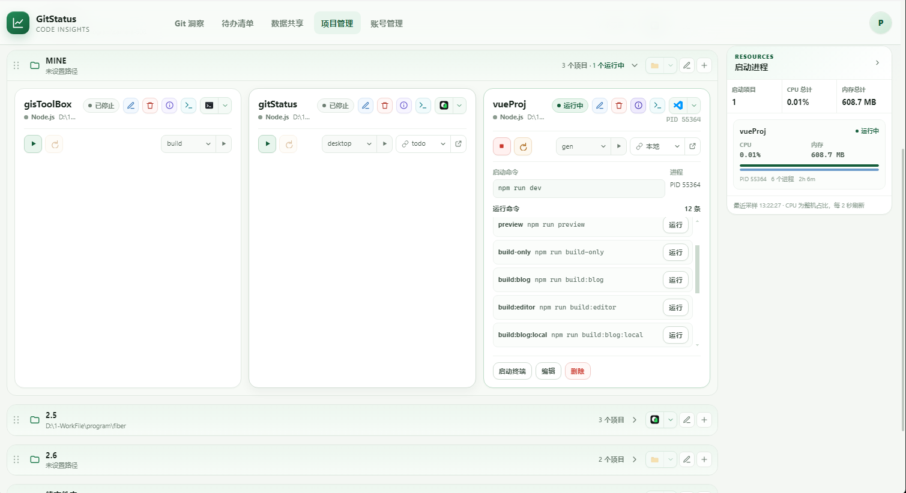

# 项目管理页面使用说明

> 页面地址：`/gitstatus/pages/projects.html`
> 这一页管理的是**运行后端的那台机器上的本地项目**：登记目录、启停进程、跑构建命令、看实时输出。
> 通用部分（导航、登录、角色、页面桌宠）见 [通用交互与登录](通用交互与登录.md)。



---

## 一、进入门槛：谁能用这一页

项目管理会在后端机器上真实启停进程，因此**门槛比其他页面更高**：账号角色必须 ≥ `读写`。页面有三种互斥的显示状态：

| 状态 | 触发条件 | 页面表现 |
| --- | --- | --- |
| 登录面板 | 没有有效 Token | 标题 `登录项目管理`，只有 `用户名` / `密码` / `登录` 三个控件 |
| 权限面板 | 已登录但角色是 `只读` | 标题 `需要读写权限`，说明文字：「项目管理会启动和停止后端机器上的进程，目前仅对读写和管理员账号开放。」，只有一个 `返回首页` 链接 |
| 正常页面 | 角色是 `读写` 或 `管理员` | 完整功能 |

> 这个校验**前后端各做一次**：前端直接换成权限面板，后端 `projectRouter` 在 `/detect` 之外的所有接口上都挂了写权限中间件，绕过页面直接调 API 会拿到 403。

---

## 二、页面骨架

```
页头：标题 + 副标题 + 工具栏（7 个按钮）
统计条：共 N 个项目 · 运行中 N · 命令在后端机器上执行
工作区：左＝项目卡片列表（按文件夹分组）   右＝进程占用侧栏
底部抽屉：项目终端（多标签）
```

副标题原文：「登记本地项目，启动或停止运行命令，并在终端里查看实时输出」。

工具栏按钮：

| 按钮 | 作用 | 备注 |
| --- | --- | --- |
| `全部展开` / `全部收起` | 一次性展开或收起所有文件夹分组 | 文案随当前状态切换；展开的是**分组**，不是卡片详情 |
| `刷新` | 重新拉取项目列表与状态 | 有项目在过渡态时页面本身也会自动轮询，见[第七节](#七控制台与终端抽屉) |
| `端口占用` | 查询并结束占用某端口的进程 | title：「查询并结束占用某端口的进程」，**仅本机可用** |
| `启动配置` | 配置需要一键启动的项目 | title：「配置需要一键启动的项目」 |
| `一键启动` | 按配置批量启动 | 未配置时按钮 title 变成「一键启动（尚未配置，点击先配置）」 |
| `新建文件夹` | 建一个分组 | 见[第四节](#四文件夹分组) |
| `添加项目` | 打开添加项目弹窗 | 主按钮 |

空态（一个项目都没有时）：标题 `还没有项目`，说明「添加一个本地项目地址，选择类型后就可以启动、停止和查看终端输出。」，按钮 `添加第一个项目`。

列表底部常驻提示原文：

> 提示：运行命令会在后端所在机器执行；Windows 下停止项目会结束整个进程树；拖动项目卡片到文件夹可快速归组。

---

## 三、添加 / 编辑项目

弹窗标题随场景变化：新建时 `添加项目` + 提交按钮 `添加项目`；编辑时 `编辑项目` + 提交按钮 `保存修改`。

### 3.1 字段清单

| 字段 | 控件 | 占位符 / 说明原文 | 规则 |
| --- | --- | --- | --- |
| 项目地址 | 文本 + `…` 按钮 + `识别` 按钮 | `例如：D:\work\my-project` | 后端机器上的**绝对路径**；hint：「填写后端机器上的项目文件夹绝对路径」。`…` 弹系统文件夹选择器，**仅本机可用**（远程点会提示只能在运行后端的本机选择文件夹） |
| 项目名称 | 文本 | `留空则使用文件夹名` | 留空时取路径最后一段 |
| 项目类型 | 下拉 | — | `自动识别` / `Node.js` / `Python` / `Java` / `Go` / `Rust` / `PHP` / `.NET` / `自定义`。选「自动识别」时由后端按文件判定 |
| 所属文件夹 | 文本 | `例如：商城系统；留空则不分组` | hint：「同一文件夹的项目会归在一个可折叠分组中，适合把前后端放在一起」。填了的名称若还没有对应文件夹，会自动创建 |
| 启动命令 | 文本 | `仅用于启动/停止，例如 npm run dev` | hint：「启动和停止都围绕这条命令进行，与下面的运行命令互不影响」 |
| 运行命令 | `添加命令` 动态行 | 名称 `名称，例如 构建`；命令 `命令，例如 npm run build` | hint：「可添加多条命令，每条命令单独执行并显示自己的终端输出，不影响启动/停止状态」。最多 50 条，单条名称/命令会被截断到 120 字符 |
| 项目介绍 | 多行文本 | `简单说明这个项目是做什么的` | hint：「只在项目卡片的展开详情中显示」 |
| 项目地址（链接） | `添加地址` 动态行 | 名称 `名称，例如 前台`；地址 `地址，例如 https://example.com` | hint：「可添加多个地址（如前台、后台、接口文档），卡片上以下拉形式展示，需以 http:// 或 https:// 开头」。最多 50 条 |

保存前的校验（提示为 toast 原文）：

| 情况 | 提示 |
| --- | --- |
| 项目地址为空 | `请输入项目地址` |
| 链接不是 http(s) 开头 | `项目地址需以 http:// 或 https:// 开头：<具体地址>` |
| 保存成功 | `项目已添加` / `项目已更新` |
| 保存失败 | `保存项目失败`（附后端返回的原因，如路径不存在、路径不是文件夹） |

### 3.2 点「识别」之后发生了什么

必须**先填项目地址**再点，否则提示 `请先填写项目地址`；按钮变 `识别中…`。后端只看项目**根目录一层**的文件名，按下面的顺序判定类型（先命中先赢）：

| 判定为 | 只要根目录存在 |
| --- | --- |
| `Node.js` | `package.json` |
| `Python` | `pyproject.toml` / `requirements.txt` / `manage.py` / `main.py` / `app.py` |
| `Java` | `pom.xml` / `build.gradle` / `build.gradle.kts` / 任意 `.jar` |
| `Go` | `go.mod` |
| `Rust` | `Cargo.toml` |
| `PHP` | `composer.json` |
| `.NET` | 任意 `.csproj` / `.sln` |
| `自定义` | 以上都不是 |

再推断**启动命令**：

| 类型 | 推断顺序 |
| --- | --- |
| Node.js | `package.json` 的 scripts 中依次找 `dev` → `start` → `serve` → `preview`，取第一个存在的；都没有则在 `index.js` / `index.mjs` / `index.cjs` / `server.js` / `app.js` / `src/index.js` 里找文件并生成 `node <文件>`；兜底 `npm start` |
| Python | `manage.py` → `python manage.py runserver`；`main.py` → `python main.py`；`app.py` → `python app.py`；兜底 `python main.py` |
| Java | `pom.xml` → `mvn spring-boot:run`；有 `gradlew`/`gradlew.bat` → `gradlew.bat bootRun`（Windows）或 `./gradlew bootRun`；否则找非 sources 的 `.jar` → `java -jar "xxx.jar"`；兜底 `mvn spring-boot:run` |
| Go | `go run .` |
| Rust | `cargo run` |
| PHP | `php -S localhost:8000` |
| .NET | `dotnet run` |
| 自定义 | 留空，需自己填 |

包管理器按 lock 文件判定：`pnpm-lock.yaml`→pnpm、`yarn.lock`→yarn、`bun.lockb`/`bun.lock`→bun、否则 npm。同一个 script 的写法会跟着变，例如 `dev` 分别得到 `pnpm run dev` / `yarn dev` / `bun run dev` / `npm run dev`（`start` 例外：npm 用 `npm start`、pnpm 用 `pnpm start`、yarn 用 `yarn start`）。

同时会**顺带生成运行命令**（最多 12 条，与启动命令重复的会被剔除）：

| 类型 | 会补充的运行命令 |
| --- | --- |
| Node.js | `package.json` 里所有 scripts，逐条转成对应包管理器命令；若一个 scripts 都没有，补一条「安装依赖 `<pm> install`」 |
| Python | 有 `requirements.txt` → 「安装依赖 `pip install -r requirements.txt`」；有 `manage.py` → 「数据库迁移 `python manage.py migrate`」；有 `pytest.ini`/`pyproject.toml`/`tests` → 「测试 `python -m pytest`」 |
| Java | Maven：「构建 `mvn clean package`」「测试 `mvn test`」；Gradle：「构建 `<runner> build`」「测试 `<runner> test`」 |
| Go | 「构建 `go build ./...`」「测试 `go test ./...`」 |
| Rust | 「构建 `cargo build`」「测试 `cargo test`」 |
| PHP | 有 `composer.json` → 「安装依赖 `composer install`」 |
| .NET | 「构建 `dotnet build`」「测试 `dotnet test`」 |

识别成功的 toast 原文形如：`已识别为 Node.js，启动命令：pnpm run dev，补充 6 条运行命令`；推断不出命令时是 `已识别为自定义项目，请手动填写启动命令`。失败提示 `项目识别失败`。

> 识别只是**填表**，不会保存；确认无误再点弹窗底部的提交按钮。

### 3.3 启动命令 ≠ 运行命令

这是这一页最容易混淆的地方：

| | 启动命令（`project.command`） | 运行命令（`project_commands`） |
| --- | --- | --- |
| 用途 | 把项目跑起来 / 停掉 | 构建、测试、装依赖等一次性任务 |
| 影响状态机 | 是，驱动 `已停止/启动中/运行中/停止中/异常` | 否，只影响自己那条命令的状态 |
| 数量 | 1 条 | 多条，各自命名 |
| 停止方式 | 卡片上的停止按钮，Windows 下结束整棵进程树 | 终端抽屉里的 `停止命令`，只停这一条 |
| 输出 | 终端抽屉里以「项目名 · 启动进程」为标签 | 终端抽屉里每条一个标签「项目名 · 命令名」 |

同一个项目**同时只能跑一条运行命令**：已有命令还在执行时再点别的运行按钮，后端会直接拒绝并提示 `已有运行命令正在执行，请先停止当前命令`，得先把当前这条停掉。

---

## 四、文件夹分组

文件夹是「一维标签」：一个项目只属于一个文件夹，空的话归到 `未分组`。

| 操作 | 入口 | 说明 |
| --- | --- | --- |
| 新建 | 工具栏 `新建文件夹`，或分组头部的 `在「X」中新建项目` | 弹窗字段：`文件夹名称`（必填，占位 `例如：商城系统`）、`文件夹路径`（可留空，占位 `例如：D:\work\shop；可留空稍后设置`，同样有 `…` 本机选择器）。hint：「同一文件夹下的项目会归在一起；设置路径后可以直接用资源管理器、VS Code 或 Qoder IDE 打开」 |
| 改名 / 改路径 | 分组头部 → `文件夹设置` | 弹窗标题变 `文件夹设置`，说明「可以修改文件夹名称和路径，项目会跟随文件夹移动」；改名后该分组下的项目自动跟随 |
| 打开目录 | 分组头部的打开按钮 + 下拉 | 没设路径时提示 `请先在文件夹设置中填写路径`；成功后 toast `已打开文件夹` |
| 收起 / 展开 | 点分组标题 | 状态记在本机，见[第十二节](#十二本机记忆的判断项) |
| 归组 | **拖动项目卡片**到分组里 | 拖到非空分组即归属该文件夹（toast `已移动到「X」`）；拖到 `未分组` 区域即移出（toast `已移出文件夹`） |
| 排序 | **拖动分组头部的拖拽手柄** | 手柄 title：`拖动调整文件夹顺序`；成功后 toast `文件夹顺序已更新` |

分组的空态文案（拖放目标提示）：

- 普通文件夹里没项目 → `拖入项目即可归到此文件夹`
- `未分组` 区 → `拖到这里可移出文件夹`

分组头部还会显示 `N 个项目`，有运行中时拼成 `N 个项目 · M 个运行`；未设置路径时显示 `未设置路径`。

---

## 五、项目卡片

卡片是操作主战场，从上到下三行：

**第一行（标题区）**：项目名、类型小圆点 + 类型名、路径（超长省略，title 里是全量）、状态徽标、以及右侧五个图标按钮 + `PID 1234`（运行中才有）。

| 图标按钮 | title | 可用条件 |
| --- | --- | --- |
| `编辑项目` | — | 始终可用 |
| `删除项目` | 忙碌时变 `请先停止项目再删除` | `已停止` / `异常` 时可点，`启动中` / `运行中` / `停止中` 时禁用 |
| `展开详情` / `收起详情` | 随状态切换 | 始终可用；详情里能看到启动命令、进程、项目介绍、运行命令清单（含条数 `N 条`） |
| `打开控制台` | — | 始终可用，打开底部终端抽屉 |
| 打开方式（分体按钮） | 见[第六节](#六打开方式与默认编辑器) | 检测不到对应工具时禁用 |

**第二行（快捷操作）**：

| 按钮 | title 的变化 | 行为 |
| --- | --- | --- |
| 启停按钮 | `启动项目` → `停止项目`；`启动中` 时是 `停止启动中的项目`；`停止中` 时是 `停止中…` 并禁用 | 图标在 ▶ 与 ■ 之间切换 |
| `重启项目` | — | **只有 `运行中` 可点**，其余状态禁用 |
| 运行命令选择器 | 触发器只显示命令**名称**，下拉里显示完整命令；下拉项 title 形如 `选择：npm run build`、`运行：npm run build` | 右侧紧挨着一个**快速运行**小按钮，直接跑当前选中的命令 |
| 项目地址选择器 | 同上，触发器显示地址名（`前台`/`后台`…） | 快速按钮用系统默认浏览器打开选中地址；没有链接时该区不显示 |

**状态机**（徽标 title 与文本一致）：

| 状态 | 显示 | 说明 |
| --- | --- | --- |
| `stopped` | `已停止` | 初始态 |
| `starting` | `启动中` | 已 spawn，还没退出过渡 |
| `running` | `运行中` | 子进程存活，卡片带高亮边框 |
| `stopping` | `停止中` | 正在结束进程树，此时启停按钮禁用 |
| `error` | `异常` | 启动即失败 / 非正常退出，卡片标红 |

运行命令另有独立的一套状态：`运行中` / `停止中` / `已完成` / `失败` / `已停止`。

启停的结果都通过 toast 反馈，原文：`项目已启动，正在读取终端输出`、`启动项目失败`、`正在停止项目`、`停止项目失败`、`正在重启项目`、`项目已重启，正在读取终端输出`、`重启项目失败`。

**编辑的限制**（后端强制）：项目处于 `启动中 / 运行中 / 停止中` 时，**名称、所属文件夹、项目介绍、链接地址随时可以改**，但启动配置（**磁盘路径**／类型／启动命令／运行命令列表）会被拒：`项目运行中，请先停止再修改启动配置`；即使项目已停，只要还有运行命令在跑，改启动配置也会提示 `请先停止正在运行的命令再修改启动配置`。另外，**改了磁盘路径或类型会重新推断一次启动命令**（除非你显式填了启动命令）。

删除会先弹确认框（`确认操作` / `取消` / `确定`），正文：`确定删除「X」吗？运行命令和项目地址会一并删除，此操作不可撤销。` 成功提示 `项目已删除`。删除的是登记信息，**不会碰磁盘上的项目目录**。

---

## 六、打开方式与默认编辑器

分体按钮：**左半边**用默认方式直接打开，**右半边（▾）**展开下拉。下拉共五项：

| 选项 | 说明 |
| --- | --- |
| `文件资源管理器` | 打开系统文件管理器 |
| `VS Code` | 需要检测到 VS Code 的命令行工具 |
| `Qoder IDE` | 需要检测到 Qoder IDE 自带的 `bin\code.cmd` |
| `在 PowerShell 中打开` | 在该目录开一个 PowerShell 窗口 |
| `在 CMD 中打开` | 在该目录开一个 CMD 窗口 |

要点：

- 检测不到的项**直接置灰**，title 变成 `未检测到 VS Code 命令行工具`（文件管理器/PowerShell/CMD 则检查系统文件是否存在）。
- 当前默认项后面带 `（默认）` 标记。
- **从下拉里选一项，就等于把它设为默认**：下次直接点左半边就是它，卡片和文件夹各自独立记忆。
- 默认项不可用时自动回退：项目按 `VS Code` → `Qoder IDE` → `文件资源管理器` 取第一个可用的；文件夹按 `文件资源管理器` → `VS Code` → `Qoder IDE`。
- 打开成功 toast `已打开编辑器`，失败 `打开编辑器失败` / `打开文件夹失败`。
- 这些操作全部在**后端机器**上执行，且远程访问时被限制（详见 [通用交互与登录 · 本机限定能力](通用交互与登录.md#43-本机限定能力)）。

---

## 七、控制台与终端抽屉

点 `打开控制台` 或 `启动终端` 从页面底部升起抽屉：

```
标签行：每个「启动进程」和每条「运行命令」各占一个标签
右侧操作：停止命令（仅运行命令标签显示） | 清空 | ✕（关闭终端）
命令条：当前标签正在跑的命令行 + PID
输出区：滚动日志
```

- 标签标题形如 `my-app · 启动进程` / `my-app · 构建`；没有名字的运行命令用命令行前两个词兜底当名字。
- `停止命令` 只结束这一条运行命令的进程树；运行中的标签按 title 显示 `停止命令`，点击后变 `停止中…`。
- `清空` 只是清掉前端当前显示，占位文案：`已清空当前显示，等待新的终端输出…`（后端缓冲区不动）。
- 各种占位：刚打开还没数据 → `正在读取终端输出…`；没有输出 → `暂无输出，启动项目后会显示终端内容`。
- 刷新页面后如果继续查看已结束的运行记录，会提示 `运行记录已失效`；命令被删掉后旧引用提示 `运行命令不存在，请刷新项目`。

**日志为什么不会越滚越大**：后端只在内存里保留每个进程最近 **600 段**输出，单段超过 **16000 字符**会截断并追加 `…[输出过长，已截断]`；**后端重启后日志全部丢失**，需要长期留存请自己重定向到文件。

**中文乱码处理**：Windows 启动命令前会自动加 `chcp 65001>nul &&` 切到 UTF-8；同时逐块探测输出编码，严格 UTF-8 解不出来就按 GBK 解，并处理跨数据块被切断的多字节字符。ANSI 转义序列在入库前被剥掉。

**轮询节奏**（页面自动做，不用手动刷新）：

| 场景 | 间隔 |
| --- | --- |
| 有项目处于过渡态（启动中/停止中） | 状态约每 1 秒拉一次，无过渡态自动停止轮询 |
| 终端抽屉打开 | 活跃时每 0.8 秒追加一次输出，空闲时 1.6 秒 |
| 进程占用侧栏展开 | 每 2 秒 |

---

## 八、启动进程资源占用侧栏

右侧栏展示「由本页启动的进程树」的资源占用：

| 区域 | 内容 |
| --- | --- |
| 概览 | `启动项目` 数量、`CPU 总计`、`内存总计`（title：「所有启动项目进程树的 CPU 占用，按整机逻辑核数归一」） |
| 列表 | 每项一行：项目名、状态、CPU、内存、`PID`、`N 个进程`、运行时长；CPU/内存各一条进度条 |
| 底部注释 | `最近采样 HH:MM:SS · CPU 为整机占比，每 2 秒刷新`；读不到时显示 `当前系统无法读取进程占用（PowerShell 或 ps 不可用）。` |

细节：

- **统计的是整棵进程树**，不只是直接启动的那个 PID；所以 `node` 起的服务会把子进程一起算进来。
- **CPU 是整机占比**（已按逻辑核数归一），单个小进程常常显示 `0.01%` 以下，此时显示 `<0.01%`。进度条按本次采样最大值归一化，否则看不出差别。
- 内存 ≥1024 MB 自动换算成 `x.x GB`。
- 点任意一条会**定位到对应卡片**：自动展开所在分组、平滑滚动到卡片、打开它的命令下拉并高亮闪烁 2 秒；找不到卡片提示 `未找到对应的项目卡片`。
- 侧栏可以收起成一条竖排 rail（`进程占用`），收起后仍有徽标显示运行中的数量。收起状态记在本机。
- 弹窗打开期间侧栏**暂停刷新**，避免整栏重绘抢帧。
- 空态：`暂无启动中的项目` / `启动项目后，这里会显示进程树占用。`

---

## 九、端口占用工具

工具栏 `端口占用` 打开弹窗，用来解决「端口被谁吃了」。

1. 输入端口（占位 `端口号，例如 30012`），点 `查询`；非法输入提示 `请输入 1-65535 之间的端口号`。
2. 空闲时显示 `端口 30012 当前没有被占用`；被占用则逐条列出进程名、PID、协议、监听地址与状态（拿不到名字显示 `未知进程`）。
3. 点某条的 `结束 PID 1234`，确认文案：`确定结束「node.exe」(PID 1234) 吗？进程会被立即终止。` 成功提示 `已结束进程`（后端返回的具体信息形如 `已结束 node.exe (PID 1234)`）。

安全闸（后端强制，任何一条命中就拒绝）：

| 规则 | 提示 |
| --- | --- |
| 只能在运行后端的本机调用 | `只能在运行后端的本机结束进程` |
| PID ≤ 4、后端自身或其父进程 | `该进程受保护，不能结束` |
| 该 PID 当前并没有占用这个端口 | `该进程已不在占用此端口` |
| 属于系统关键进程（`System`、`Idle`、`smss/csrss/wininit/winlogon/services/lsass/svchost/explorer/dwm/fontdrvhost` 等） | `「svchost.exe」是系统进程，已阻止结束` |
| 权限不足 | `结束进程失败，可能需要管理员权限` |

> Windows 下结束进程使用 `taskkill /PID <pid> /T /F`，即连子进程一起杀。

---

## 十、一键启动

`启动配置` 打开 `一键启动配置` 弹窗：列出所有项目（含所属文件夹，未命名项目显示 `未命名项目`、无分组显示 `未分组`），提供 `全选` / `清空`，勾选后点 `保存配置`。

- 保存提示 `已保存 N 个一键启动项目`；一个都没勾提示 `已清空一键启动配置`；还没有项目时列表显示 `还没有项目，请先添加项目`。
- 配置**存在后端**（`GET/PUT /projects/quickstart`），换浏览器、换机器登录同一账号都能看到；本机另存一份副本仅用于首屏秒显。
- 工具栏按钮 title 会随配置变化：`一键启动已配置的 3 个项目`，未配置时是 `一键启动（尚未配置，点击先配置）`，弹窗里已选数量显示为 `已选 3 个`。
- 点 `一键启动` 后按顺序启动，跳过已在运行/启动中的项目，结果 toast：`一键启动完成：成功 2 个，失败 1 个`（全部成功时简化为 `已一键启动 2 个项目`）。
- 三种提前退出的情况：`还没有配置一键启动项目`、`配置的项目已不存在，请重新配置`、`配置的项目都已在运行或启动中`。

> **桌面版联动**：这套配置保存在后端 `project_quickstart` 表（接口 `GET/PUT /projects/quickstart`），桌面端托盘不再读取它；桌面端托盘的「启动后台」启动的是 GitStatus 后端本身，不是这里的项目。

---

## 十一、接口对应

| 页面动作 | 接口 |
| --- | --- |
| 项目识别 | [POST `/projects/detect`](../后端API说明.md) |
| 项目增删改查、启停重启 | [项目管理 API](../后端API说明.md) |
| 运行命令执行与日志 | 同上（`/commands/:id/run`、`/runs/:id/logs`、`/runs/:id/stop`） |
| 进程占用侧栏 | GET `/projects/usage` |
| 编辑器可用性 | GET `/projects/editors` |
| 打开项目 / 打开文件夹 | POST `/projects/:id/open-editor`、`/projects/folders/open-editor` |
| 文件夹增删改与排序 | `/projects/folders`、`/projects/folders/reorder` |
| 项目换分组 | PATCH `/projects/:id/folder` |
| 端口查询 / 结束进程 | GET `/projects/ports/:port`、POST `/projects/ports/:port/kill` |
| 一键启动配置 | GET / PUT `/projects/quickstart` |
| 本机文件夹选择器 | POST `/projects/pick-folder`（仅 loopback） |

---

## 十二、本机记忆的判断项

都存在 `localStorage`，只影响当前浏览器：

| 键 | 存什么 |
| --- | --- |
| `gitstatus_project_default_editors` | 每个项目的默认打开方式 |
| `gitstatus_project_folder_default_editors` | 每个文件夹的默认打开方式 |
| `gitstatus_projects_usage_collapsed` | 进程占用侧栏是否收起 |
| `gitstatus_project_folders_collapsed` | 哪些文件夹分组被收起 |
| `gitstatus_projects_oneshot_ids` | 一键启动配置的本地镜像（权威数据在后端） |

登录态使用全站共用的 `gitstatus_todo_token` / `gitstatus_todo_user`，见 [通用交互与登录 · 本地存储键位总表](通用交互与登录.md#六本地存储键位总表)。

---

## 十三、常见问题

**Q：路径填了我自己电脑上的目录，结果报错找不到？**
填的是**后端那台机器**上的路径。远程使用网页端时，后端在另一台机器（或服务器）上。

**Q：为什么只读账号连"看"都看不了？**
这是设计如此 —— 这一页的每个操作都会动进程，不做只读模式。需要看的人请让管理员升为 `读写`，或改用[账号管理](账号管理.md)。

**Q：项目明明还在跑，页面显示 `异常`？**
进程异常退出或被外部结束时状态会转为 `异常`。确认实际进程后点 `启动项目` 重新拉起，或 `刷新` 同步状态。

**Q：停止项目后端口还占着？**
Windows 下停止使用 `taskkill /T /F`，正常会连子进程一起结束。若是被别的方式启动的同名进程占用，用[第九节](#九端口占用工具)的端口工具处理。

**Q：终端里的历史不见了？**
日志只在内存中保留最近 600 段，后端重启即清空；`清空` 按钮也只影响当前显示。

**Q：`识别` 出来的启动命令不对？**
识别只看根目录一层文件，Monorepo、自定义脚本名（如 `npm run local`）判不准。手动改启动命令即可，类型下拉也可强制指定后重新识别。

**Q：为什么启动命令改不了，提示“项目运行中”？**
启动配置（磁盘路径／类型／启动命令／运行命令）必须在项目完全停止、并且没有运行命令在跑时才能改；名称、分组、介绍、链接地址则随时可改，见[第五节](#五项目卡片)。

---

## 相关文档

- [通用交互与登录](通用交互与登录.md) · [待办清单](待办清单.md) · [后端 API 说明](../后端API说明.md) · [桌面端使用说明](../桌面端使用说明.md) · [文档索引](../README.md)
